# TolongMeeting TRD

The technical design of TolongMeeting and the code-level decisions every plan shares: architecture, components, state machines, security, platform realities, repository layout, tooling, shared types, interfaces between packages, on-disk data layout and environment variables. Each milestone plan builds against this page, so the names from [repository layout](#repository-layout) onwards are binding; a plan that needs to change one updates this page in the same commit. It implements the [PRD](PRD.md), revision 2 of the approved design, for the product in [PRODUCT.md](PRODUCT.md), and the screens are in the [design](DESIGN.md). Component deep-dives are in [`docs/trd/`](#components).

Contents:

1.  [Architecture overview](#architecture-overview)
1.  [Components](#components)
1.  [Tech stack](#tech-stack)
1.  [State machines](#state-machines)
1.  [Data and storage](#data-and-storage)
1.  [Security and privacy](#security-and-privacy)
1.  [Platform realities](#platform-realities)
1.  [Lessons carried over from the session](#lessons-carried-over-from-the-session)
1.  [Deployment and cost](#deployment-and-cost)
1.  [Testing approach](#testing-approach)
1.  [Early spikes](#early-spikes)
1.  [Repository layout](#repository-layout)
1.  [Tooling and conventions](#tooling-and-conventions)
1.  [Runtime processes](#runtime-processes)
1.  [Core types](#core-types)
1.  [Worker interfaces](#worker-interfaces)
1.  [AI, notification and pipeline interfaces](#ai-notification-and-pipeline-interfaces)
1.  [Data directory layout](#data-directory-layout)
1.  [Database](#database)
1.  [Environment variables](#environment-variables)
1.  [Plan conventions](#plan-conventions)
1.  [Contract additions and reconciliation](#contract-additions-and-reconciliation)
    1.  [Additions by plan](#additions-by-plan)
    1.  [Changed shapes](#changed-shapes)
    1.  [Name reconciliation](#name-reconciliation)
    1.  [Known follow-ups](#known-follow-ups)

## Architecture overview

TolongMeeting is one TypeScript repository deployed with Docker Compose on one server. The member's browser reaches a Caddy reverse proxy, which serves the Next.js website and API, the self-hosted ntfy server and, for the signed-in owner only, the remote view of a worker's desk. Postgres holds the data and the job queue. The scheduler turns timetable entries into occurrences and starts one worker container per occurrence through a restricted Docker socket proxy. The worker attends the meeting, records and watches it, and sends heartbeats to the server; the reply carries the member's commands. When the worker exits, the pipeline builds the transcript, slides, chat and summary, and the member is pinged. On the member's PC, the Electron companion app shows notifications, saves summaries, runs native transcription and, for identities set to run locally, runs the same worker container.



| Process               | What it does                                                           | Where                                      |
| --------------------- | ---------------------------------------------------------------------- | ------------------------------------------ |
| `tm-web`              | Website and API                                                        | Server, behind Caddy                       |
| `tm-scheduler`        | Expands timetables, runs the queue, launches workers, deletes old data | Server                                     |
| `tm-worker`           | Attends one meeting occurrence                                         | Server, or the member's PC through Docker  |
| `tm-pipeline`         | Builds the transcript, slides, chat and summary after the worker exits | Server, or the member's PC for native mode |
| `tm-companion`        | Notifications, summary files, native transcription, local mode         | The member's PC                            |
| ntfy, Caddy, Postgres | Pings, HTTPS and WebSocket proxy, data and queue                       | Server                                     |

The packages, milestones and entry points behind these processes are in [runtime processes](#runtime-processes) and [repository layout](#repository-layout).

## Components

Each component has a deep-dive under `docs/trd/`. The binding names, types and interfaces stay on this page, from [repository layout](#repository-layout) onwards.

| Component                     | Technical design                                                                    | Requirements                                                |
| ----------------------------- | ----------------------------------------------------------------------------------- | ----------------------------------------------------------- |
| Website and API               | [Website and API](trd/website-and-api.md)                                           | [Website and accounts](PRD.md#website-and-accounts)         |
| Scheduler                     | [Scheduler](trd/scheduler-and-control.md#scheduler)                                 | [Scheduling and attending](PRD.md#scheduling-and-attending) |
| Control channel               | [Control channel](trd/scheduler-and-control.md#control-channel)                     | [Scheduling and attending](PRD.md#scheduling-and-attending) |
| Meeting worker                | [Meeting worker](trd/meeting-worker.md#meeting-worker)                              | [Scheduling and attending](PRD.md#scheduling-and-attending) |
| Platform adapters             | [Platform adapters](trd/meeting-worker.md#platform-adapters)                        | [Scheduling and attending](PRD.md#scheduling-and-attending) |
| Link watchers                 | [Link watchers](trd/link-watchers.md)                                               | [Link watching](PRD.md#link-watching)                       |
| Attendance form handler       | [Attendance form handler](trd/attendance-forms.md)                                  | [Attendance forms](PRD.md#attendance-forms)                 |
| Name-mention detection        | [Name-mention detection](trd/transcription-and-summaries.md#name-mention-detection) | [Name mentions](PRD.md#name-mentions)                       |
| Transcription                 | [Transcription](trd/transcription-and-summaries.md#transcription)                   | [Transcription](PRD.md#transcription)                       |
| Post-processing and summaries | [Post-processing](trd/transcription-and-summaries.md#post-processing)               | [Summaries](PRD.md#summaries)                               |
| Notifications                 | [Notifications](trd/notifications-and-companion.md#notifications)                   | [Notifications](PRD.md#notifications)                       |
| Companion app                 | [Companion app](trd/notifications-and-companion.md#companion-app)                   | [Companion app](PRD.md#companion-app)                       |
| Run locations                 | [Run locations](trd/notifications-and-companion.md#run-locations)                   | [Run locations](PRD.md#run-locations)                       |
| Exports                       | [Exports](trd/exports.md)                                                           | [Exports](PRD.md#exports)                                   |

## Tech stack

All designer's calls.

- **Language**: TypeScript throughout, one repository with Bun workspaces (Bun is the requester's default package manager and runner).
- **Website and API**: Next.js, run with Bun. GitHub sign-in restricted to the TolongLabs organisation.
- **Reverse proxy**: Caddy, for HTTPS, the website, ntfy, and the noVNC WebSockets (through `forward_auth`, because Next.js route handlers don't proxy WebSockets on their own).
- **Database and queue**: Postgres, with a Postgres-backed job queue (for example pg-boss), so there's no Redis.
- **Meeting worker**:
  - **Browser**: Playwright driving pinned full Chrome, run on Node 24 inside the container, because Playwright officially supports Node.
  - **Display and audio**: Xvfb, openbox, PulseAudio.
  - **Capture**: ffmpeg for recording and frames.
  - **QR decoding**: zxing-cpp (WebAssembly build) and OpenCV's WeChat detector, compared in [spike 3](#early-spikes). Ruling (supersedes the spike's rule result `qr.decoder=wechat`): `decodeQr` returns the union of three stages, with no first-hit stop: zxing on the full stage frame, zxing on the 2x Lanczos-upscaled shared-screen region (when a region is known), and WeChat on the full frame. WeChat's region pass is dropped, since it added nothing in the spike. WeChat runs in one long-lived Python process per worker (`src/qr/wechat_bridge.py`, newline-delimited JSON on stdin and stdout). There is no zxing-only fallback: if the bridge cannot start or dies, `decodeQr` throws `WechatBridgeError` and the caller (the frame loop, plan 01a Task 18) decides; the next call starts a fresh bridge.
  - **Remote view**: x11vnc clipped to the desk half, served by noVNC.
- **Docker access**: a restricted Docker socket proxy (for example `tecnativa/docker-socket-proxy` with only the needed endpoints).
- **Notifications**: self-hosted ntfy.
- **Cloud AI (bring your own key)**: each member's own DashScope key, Singapore region, through the OpenAI-compatible endpoint (`https://dashscope-intl.aliyuncs.com/compatible-mode/v1`, or the workspace endpoint `https://{WorkspaceId}.ap-southeast-1.maas.aliyuncs.com/compatible-mode/v1` when a Workspace ID is given). One client takes a configurable base URL and a model ID per task, with thinking mode off unless a task's tests show it's needed. Defaults as of 20 October 2026 (re-check at build time; details in [AI providers](research/ai-providers.md)):
  - **Summaries**: `qwen3.7-plus`.
  - **Slide reading**: `qwen3-vl-plus`.
  - **Form-label matching**: the cheapest current flash model (`qwen-flash`, or `qwen3.7-flash` if it's cheaper and as fast at build time).
  - **Live speech recognition**: `qwen3-asr-flash-realtime`, over WebSocket rather than the OpenAI-compatible endpoint.
- **ModelScope**: an alternative provider for text tasks, with its own model-ID mapping, for members who prefer it. Its free quota is unclear and has no service guarantee, and access may need mainland China identity checks. It is never used for live speech recognition, and never as the only route for form matching.
- **Companion app**: Electron, for a reliable tray icon, click-to-open notifications with a registered app ID on Windows, child processes and `safeStorage`.
- **Deployment**: Docker Compose on one server.

## State machines

The diagrams show each state machine as three occurrence parts and two form parts, in reading order. The text blocks below list the same states and transitions.


Meeting occurrence (stored in Postgres; every transition is an event):

```text
scheduled -> starting -> verifying_accounts -> watching_for_link -> joining -> in_lobby -> in_meeting -> leaving -> uploading -> transcribing -> post_processing -> completed

Side exits:
  verifying_accounts  -> waiting_for_signin -> verifying_accounts      (member signs in)
  watching_for_link   -> no_link                                       (30 minutes after start)
  in_lobby            -> denied | in_lobby (knock again, at most 2; `occurrences.knocks`)
  any running state   -> restarting -> previous state                  (up to 3 times; `occurrences.restarts`, `resume_state`)
  any running state   -> left_by_member                                (leave_now or take_over)
  starting            -> skipped_capacity | skipped_identity_clash | skipped_pc_offline
  transcribing        -> waiting_for_pc                                (native mode: no PC claimed the job within 120 s, or its lease lapsed)
  waiting_for_pc      -> transcribing                                  (a PC claimed the job: `pc_claimed`)
  waiting_for_pc      -> post_processing                               (the PC uploaded the transcript: `transcript_ready`)
  any state           -> failed                                        (with reason)
completed | failed | ... -> deleted                                    (30 days after the meeting)
```

Attendance form:

```text
detected -> resolving -> checking_trust -> opening -> inspecting -> filling -> submitting -> submitted

Side exits:
  checking_trust -> untrusted                         (ping)
  inspecting     -> not_attendance | quiz             (ping)
  opening        -> awaiting_signin -> opening        (member signs in; once)
  filling        -> needs_member                      (unmatched required question; ping)
  submitting     -> already_answered                  (ping)
  any            -> failed                            (ping)
```

The names are the `OccurrenceState` and `FormState` types in [core types](#core-types).

## Data and storage

Main records (designer's sketch). The binding tables are in [database](#database), and the files on disk are in [data directory layout](#data-directory-layout).

- **Member**: GitHub identity, display name, time zone, ntfy topic, role.
- **Identity**: a member's named sign-in identity (for example University, Work), its run location and Zoom guest display name.
- **Browser profile**: one per identity; latest encrypted checkpoint, last-verified time per account, and where it lives.
- **Details**: saved form values with label variants, and names for mention alerts.
- **Timetable entry**: the fields in the [entry form](DESIGN.md#timetable-and-entry-form).
- **Meeting occurrence**: entry, scheduled and actual times, state, worker attempts, transcription mode, and the link used. Passcodes are removed from the stored link once the meeting ends.
- **Artefacts**: recording, frames, slides, transcript, chat and summary, as files on disk referenced by path.
- **Form record**: URL, source, sender, trust reason, times, state, fields filled (names only in logs), screenshots, result.
- **Event**: timestamped log per occurrence (joined, notice dismissed, form seen, alert, error, deletion).
- **Connection**: export target tokens, encrypted.

Retention is a requirement; see [retention](PRD.md#retention).

## Security and privacy

- **Browser profiles** are the most sensitive data: they hold live sessions for university, work, WhatsApp and Discord accounts.
  - **Encryption**: each identity's checkpoints are encrypted with AES-256-GCM under a key derived from the server master key and the identity's id (HKDF).
  - **Master key**: kept in a Docker secret file outside the database and the repository.
  - **Working copies**: live only on an encrypted host volume, mounted only into that identity's worker.
- **Honesty about admins**: isolation between members is enforced by the app, the API and the identity lock. A person with root access to the server can read everything, so only trusted maintainers get server access (anti-goal 6).
- **Starting containers**: the scheduler talks to Docker through a restricted socket proxy that allows only creating, starting, stopping and inspecting worker containers from the fixed worker image with fixed mounts. It blocks `exec`, archive downloads, privileged mode and other images.
- **Network**: worker containers may reach the public internet (HTTPS, and the UDP and TCP ports WebRTC media needs) and the app's own API. They are blocked from private address ranges (`10.0.0.0/8`, `172.16.0.0/12`, `192.168.0.0/16`), link-local and cloud metadata addresses (`169.254.0.0/16`, `fe80::/10`) and other containers. A domain allowlist isn't used, because university sign-in, link redirects and media relays reach unpredictable hosts.
- **Remote view**: noVNC reaches the desk side of a worker only, through Caddy with `forward_auth` against the website, for the owning member. It closes after 15 minutes idle. x11vnc listens on the container's loopback only, asks for a per-session password derived from the control token's hash, and is interactive only during a sign-in or a desk pause. The managed Chrome policy blocks local files, developer tools and downloads.
- **Secrets**: export tokens, ntfy tokens and members' AI keys are encrypted at rest and never logged.
- **Logs**: logs and events redact meeting passcodes, tokens and form field values; only field names are logged, and values show on the member's own meeting page. No personal data or secrets go in URL query strings, except where a platform's own meeting link requires a passcode.
- **Form text is untrusted**: the form-matching model only sees question labels and options, cut to 120 characters, and must answer in a fixed JSON schema. Form descriptions never reach a model.
- **Cloud AI**: transcripts, slides and form questions go to Alibaba Cloud on the member's key. Alibaba's policy (updated 1 October 2026) keeps prompts and responses for up to 30 days and doesn't use business inputs for training without consent. The AI keys page states this.
- **Signing in**: the app never automates a login form and never stores a password. When a session expires, it asks the member to sign in again.

The recording-others and consent rules are requirements; see [privacy and consent](PRD.md#privacy-and-consent).

## Platform realities

From research and expert review on 20 October 2026; verify before relying on them. Details: [platform constraints](research/platform-constraints.md).

- **Zoom**: since March 2026, Meeting SDK apps that join other accounts' meetings need Zoom-issued authorisation tokens and app review. This design avoids that by using the web client signed in as the member.
  - **One meeting per account**: a signed-in account can't usually be in two meetings at once, and joining the same meeting from a second device disconnects one session. That's why the Zoom adapter has a guest fallback and pings have a "Take over" button.
  - **Guest joins**: joining through the web client as a guest worked on 19 October 2026.
- **Teams**: from about the end of October 2026, Teams detects and labels external meeting-assistant bots in the lobby, with organiser approval required. A signed-in member joining from a browser isn't expected to be labelled, but this is unverified (spike 2).
- **Google Meet**: the Meet Media API no longer accepts new registrations. Guests can land in a review queue that defaults to deny, while signed-in members of the host's organisation can join directly. Meet blocks browsers that report automation, hence the Chrome settings above. A Meet code reopens as an empty room after the host ends the call, so a rejoin is accepted unless the end screen shows, which the join reports as `meeting_ended`.
- **University and work sign-in policies**: institutions may limit how long web sessions last on unmanaged devices, re-check sessions when the address changes, or require managed devices. Reusing a session from a data centre while the member is active elsewhere can look like impossible travel. Spike 1 measures this, and the run locations give two ways round it.
- **Chat apps**: Discord and WhatsApp terms forbid automating personal accounts; see [link watchers](trd/link-watchers.md).
- **Borrowed code**: joinly and screenappai/meeting-bot are MIT-licensed and fine to borrow join flows from, with attribution. Attendee uses the Elastic License 2.0; read it for ideas only. Details: [open-source meeting bots](research/open-source-meeting-bots.md).

## Lessons carried over from the session

Requirements that come straight from the [problems and fixes](session-record/problems-and-fixes.md) catalogue:

- Never synthesise keyboard or mouse input on a member's desktop; the worker runs on its own virtual screen ([SAFE-02](session-record/problems-and-fixes.md#safe-02-os-level-keystrokes-went-to-the-users-whatsapp), [DESK-02](session-record/problems-and-fixes.md#desk-02-restoring-chrome-stole-focus-and-covered-the-users-work)).
- Alert on black frames from the first seconds, and never let the recorded window be covered or hidden ([DESK-01](session-record/problems-and-fixes.md#desk-01-chrome-meeting-window-minimised-during-capture), [OBS-04](session-record/problems-and-fixes.md#obs-04-obs-recorded-black-frames-while-chrome-was-covered), [CAP-03](session-record/problems-and-fixes.md#cap-03-the-watcher-missed-black-frames-and-the-gap-was-misdated)).
- Join through the web-client URL, never the launcher page ([ZOOM-05](session-record/problems-and-fixes.md#zoom-05-zooms-launcher-page-opened-the-desktop-app)).
- Detect the meeting end from page signals, checked every few seconds ([CAP-04](session-record/problems-and-fixes.md#cap-04-the-watcher-did-not-detect-the-meeting-end)).
- Treat chat as a virtualised list: keep it at the bottom, sweep it periodically, store it as it arrives, and advance cursors only after a durable write ([CHAT-02](session-record/problems-and-fixes.md#chat-02-the-virtualised-chat-list-hid-new-messages), [CHAT-03](session-record/problems-and-fixes.md#chat-03-the-pull-cursor-skipped-messages-that-were-never-saved)).
- Re-resolve browser tabs by purpose on every step; never hold tab handles across restarts ([BRW-08](session-record/problems-and-fixes.md#brw-08-the-extensions-tab-group-and-tab-ids-were-lost)).
- Run one heavy transcription job at a time, and budget memory per worker ([ASR-02](session-record/problems-and-fixes.md#asr-02-transcription-jobs-were-killed-for-low-memory)).
- Correct names from slides and other authoritative sources ([ASR-04](session-record/problems-and-fixes.md#asr-04-every-engine-misheard-proper-nouns)).
- Record into crash-safe Matroska segments, and write every capture incrementally.

## Deployment and cost

- **Server**: one virtual machine in Singapore with 8 vCPUs, 16 GB of memory and 200 GB of disk, running at most 2 meetings at once (decision 38).
  - **Per worker**: the expert review estimates 2.5 to 3.5 vCPUs and 3.5 to 4.5 GB, because Chrome renders video in software without a GPU. [Spike 6](#early-spikes) measures the real figure, and the concurrency cap is set from it.
  - **Cost**: about US$45 to 80 a month.
- **Cloud AI**: paid by each member on their own DashScope key. Estimates from Alibaba's Singapore price list of 19 October 2026 (check the console; the English and Chinese pages disagree on speech pricing):
  - live speech recognition: about US$0.32 per meeting hour;
  - a lecture summary: about US$0.02;
  - slide reading: about US$0.05 for 60 slides;
  - form matching: a fraction of a cent.

  A 2-hour lecture comes to roughly US$0.70; native mode removes the speech cost.

- **Native mode**: free per minute; uses the member's GPU.
- **Backups**: nightly Postgres dump and encrypted profile checkpoints to off-server storage, kept for 7 days so deleted meetings don't linger (designer's call).
- **HTTPS**: a TolongLabs subdomain through Caddy.
- **Worker network firewall** (`docker/firewall/`): install on the host as root, once: copy `worker-egress.sh` to `/usr/local/sbin/tm-worker-egress.sh` (mode 755), `tm-worker-egress.service` to `/etc/systemd/system/` and `docker.service.d/10-tm-egress.conf` to `/etc/systemd/system/docker.service.d/`, then `systemctl daemon-reload && systemctl enable --now tm-worker-egress.service`, and restart Docker. The unit runs before `docker.service` and Docker requires it, so no worker can start without the rules, and a failed script keeps Docker down. The script is fail-closed and atomic: it makes the chains `TM-WORKERS` and `DOCKER-USER` if missing, fills `TM-WORKERS` (flush, every rule and the final `-j DROP`) in one `iptables-restore --noflush` transaction, adds the `DOCKER-USER` and `INPUT` hooks only after that, and exits non-zero unless the last rule is the DROP. It denies the private, link-local, carrier-grade NAT, `0.0.0.0/8`, `127.0.0.0/8`, `192.0.0.0/24`, `198.18.0.0/15` and `224.0.0.0/3` ranges. IPv6 has no rules: the `tm-workers` network has no IPv6 and every worker runs with `net.ipv6.conf.all.disable_ipv6=1`, which is what keeps it off IPv6. After each install or Docker upgrade run `docker/firewall/check-egress.sh <public host>`: it also probes worker to worker, the app network's gateway and the Docker proxy.

## Testing approach

Acceptance tests run on real meetings and are listed in the [PRD](PRD.md#acceptance-tests). The code is tested as [tooling and conventions](#tooling-and-conventions) describes: end-to-end and integration tests through each package's public entry points, and Playwright against static fixtures of each platform's pages for the worker. The monthly smoke test in [platform adapters](trd/meeting-worker.md#platform-adapters) joins each platform's test meeting.

**Test accounts** (designer's call): TolongLabs' own test accounts weren't confirmed. Build organisation-restricted test forms with the member's own university account, since students can usually create forms limited to their university. Host test meetings from free accounts, keeping Zoom tests under its 40-minute free limit. Run the 90-minute test on Google Meet, Teams, or a university-licensed Zoom account.

## Early spikes

Throwaway checks before milestone 1A, because each could change the design:

1.  **Sign-in from the server**: sign in to the member's university Microsoft and Google accounts, and their work account, in a worker on the Singapore server.
    - Reopen the profile a day and a week later.
    - Join a meeting and open an organisation-restricted form while the member is actively using the same accounts in Malaysia.
    - Check whether the work tenant demands a managed device for Teams.

    Repeat through a Tailscale exit node at home. The results set each identity's default run location.

1.  **Browser in the container**: signed-in joins, audio heard, chat read and end detected on Zoom, Teams and Meet, in Xvfb on the server. This also covers:
    - the Chrome flags, the policy and the stage and desk layout;
    - muting desk tabs;
    - whether Teams labels a signed-in browser as a bot.
1.  **QR decoding**: share slides with QR codes of different sizes from another account, with the chat panel open. Measure decode rate and time with zxing-cpp and OpenCV WeChat on 1080p stage frames.
1.  **Forms**: use a two-page Google Form and a two-page Microsoft Form restricted to an organisation, with:
    - name and ID questions;
    - an attendance confirmation;
    - radio, checkbox and dropdown questions;
    - a required free-text question.

    The handler must fill the first ones and refuse the free text. Also test "already responded", an expired login, an untrusted sender, and a Safe Links-wrapped link.

1.  **Speech recognition**: a 15-minute recording of a Malaysian lecture mixing English and Malay through `qwen3-asr-flash-realtime`. Check accuracy, stream-offset timestamps and reconnection, and look for a streaming model with native timestamps and vocabulary support.
1.  **Resources**: CPU, memory and disk per worker over 2 hours, with chat watchers open.
1.  **Profile persistence**: archive, encrypt and restore a profile signed in to Google, Microsoft, Zoom, Discord and WhatsApp Web across 3 fresh containers over 24 hours, including one forced crash. Check that cookies survive (`--password-store=basic`, fixed machine ID) and that WhatsApp stays linked.
1.  **ntfy attachments**: whether attachments can require authentication and expire within 3 hours.

## Repository layout

```text
TolongMeeting/
├── package.json              Bun workspaces root ("workspaces": ["packages/*"]); scripts: lint, lint:fix, test, typecheck, graph
├── bun.lock
├── tsconfig.json             strict, ES2023, moduleResolution "bundler"; packages extend it
├── .prettierrc.json          TolongLabs default (printWidth 120, single quotes, no semicolons)
├── commitlint.config.mjs     conventional commits, header 50 characters at most
├── .env.example              every variable in "Environment variables", no values
├── config/
│   └── selectors/            zoom.json, teams.json, meet.json (adapter selector maps)
├── docker/
│   ├── worker/               Dockerfile, entrypoint.sh, openbox/rc.xml, chrome-policy.json, pulse/default.pa, versions.env
│   ├── compose.yaml          caddy, web, scheduler, pipeline, postgres, ntfy, docker-proxy (milestone 1C)
│   ├── caddy/Caddyfile
│   ├── app/Dockerfile        targets web, scheduler and gate
│   └── firewall/             worker-egress.sh, tm-worker-egress.service, docker.service.d/, check-egress.sh
├── packages/
│   ├── core/                 shared types, config schemas (zod), state machines, time helpers. No I/O.
│   ├── ai/                   OpenAI-compatible chat client, DashScope real-time ASR client
│   ├── notify/               ntfy client
│   ├── worker/               the meeting worker (runs on Node 24 in the worker image)
│   ├── pipeline/             post-processing: transcript, slides, chat, summary
│   ├── scheduler/            occurrence expansion, job queue, container launcher, retention (1C)
│   ├── web/                  Next.js website and API (1C)
│   ├── companion/            Electron companion app (milestone 3)
│   └── exports/              export targets (milestone 7)
├── spikes/                   throwaway spike code, one folder per spike, each with REPORT.md
└── docs/                     this documentation
```

## Tooling and conventions

- **Runtimes**: Bun 1.x for everything except the worker. The worker runs on Node 24, because Playwright officially supports Node; it is still written in TypeScript and built with `bun build --target=node`.
- **Workspace setup**: copied from `TolongLabs/sdp-hack`: `AGENTS.md` (with `CLAUDE.md` and `GEMINI.md` linking to it), `docs/agents/`, `docs/references/`, the skills in `.agents/skills/` and `.claude/skills/`, `.claude/settings.json`, `.codex/hooks.json`, husky hooks, CI and the Graphify graph in `graphify-out/graph.json`. [Project conventions](references/project-conventions.md) apply to every plan.
- **Language**: TypeScript strict everywhere; `bun run typecheck` runs `tsc` at the root (scripts and tests) and then each package's `tsc` (its `src`).
- **Validation**: zod for every config file, API body and JSON produced by a model.
- **Tests**: `bun test`, in `packages/<package>/test/*.test.ts` and the root `test/` and `e2e/`. Following the project conventions, tests prove behaviour through each package's public entry points the way its callers use it (the worker against fixture pages, the pipeline CLI against an occurrence directory, the website and scheduler against a real Postgres), not private helpers. The behaviour cases each plan lists (state machines, trust rules, link unwrapping, summary rendering, schedulers) are kept, exercised through those entry points.
- **Browser integration tests**: Playwright Test on Node 24, in `packages/worker/test/`, against static HTML fixtures in `packages/worker/test/fixtures/` that imitate each platform's DOM and the two form providers. Run with `bunx playwright test -c packages/worker/playwright.config.ts`.
- **Formatting**: Prettier, `bun run lint` to check and `bun run lint:fix` to fix, with husky and lint-staged on commit, as in other TolongLabs repositories. A change is done when `bun run lint` passes.
- **Commits**: conventional commits (`feat:`, `fix:`, `test:`, `chore:`, `docs:`), header at most 50 characters, one task per commit or less.
- **Secrets**: never committed, never logged, never in URL query strings of the app's own API. `.env.example` lists names only.
- **Pinned versions**: Chrome, Playwright, ffmpeg, Node and Bun versions for the worker image live in `docker/worker/versions.env`, set by spike 2 and changed only together with a passing smoke test. `scripts/build-worker-image.sh` passes every key (`NODE_VERSION`, `CHROME_VERSION`, `PLAYWRIGHT_VERSION`, `FFMPEG_VERSION`, `BUN_VERSION`, `BUN_SHA256`) as a build argument of the same name and tags the image both `tm-worker:dev` and `tolongmeeting/worker:current`.

## Runtime processes

| Process        | Package              | Milestone | Runs                                                                                                   |
| -------------- | -------------------- | --------- | ------------------------------------------------------------------------------------------------------ |
| `tm-worker`    | `packages/worker`    | 1A        | One container per meeting occurrence, from the worker image                                            |
| `tm-pipeline`  | `packages/pipeline`  | 1A        | After the worker exits: a CLI in 1A, a pg-boss job consumer in 1C                                      |
| `tm-web`       | `packages/web`       | 1C        | Next.js website and API, behind Caddy                                                                  |
| `tm-scheduler` | `packages/scheduler` | 1C        | Expands timetables, runs the queue, launches workers through the Docker socket proxy, deletes old data |
| `tm-companion` | `packages/companion` | 3         | Electron app on the member's PC                                                                        |

In milestone 1A there is no server: `bun run tm-worker -- --job job.json` inside the worker image runs one meeting from a job file, then `bun run tm-pipeline -- --job job.json` post-processes it.

## Core types

`packages/core/src/types.ts`. These names are used by every plan.

```ts
export type Platform = 'zoom' | 'teams' | 'meet'
export type EntryType = 'lecture' | 'work'
export type TranscriptionMode = 'live' | 'native'
export type RunLocation = 'server' | 'server_via_home' | 'local'
export type SenderRole = 'host' | 'co_host' | 'participant' | 'unknown'

export type OccurrenceState =
  | 'scheduled'
  | 'starting'
  | 'verifying_accounts'
  | 'waiting_for_signin'
  | 'watching_for_link'
  | 'no_link'
  | 'joining'
  | 'in_lobby'
  | 'denied'
  | 'in_meeting'
  | 'restarting'
  | 'left_by_member'
  | 'leaving'
  | 'uploading'
  | 'transcribing'
  | 'waiting_for_pc'
  | 'post_processing'
  | 'completed'
  | 'skipped_capacity'
  | 'skipped_identity_clash'
  | 'skipped_pc_offline'
  | 'failed'
  | 'deleted'

export type FormState =
  | 'detected'
  | 'resolving'
  | 'checking_trust'
  | 'untrusted'
  | 'opening'
  | 'awaiting_signin'
  | 'inspecting'
  | 'not_attendance'
  | 'quiz'
  | 'filling'
  | 'needs_member'
  | 'submitting'
  | 'submitted'
  | 'already_answered'
  | 'failed'

export type FormSource = 'qr' | 'meeting_chat' | 'watched_chat'
export type FormProvider = 'google' | 'microsoft'
export type TrustReason = 'qr_on_screen' | 'host' | 'co_host' | 'trusted_sender' | 'org_restricted'

export interface ChatMessage {
  key: string // platform message id, else `${sender}|${time}|${text.slice(0, 200)}`
  sender: string
  senderRole: SenderRole
  time: string // as displayed by the platform
  seenAt: string // ISO 8601, when the worker read it
  text: string
  links: string[] // absolute URLs found in the message
}

export interface FormCandidate {
  url: string
  source: FormSource
  sender: string | null
  senderRole: SenderRole | null
  seenAt: string
}

export interface ResolvedForm extends FormCandidate {
  finalUrl: string
  provider: FormProvider
}

export interface SavedDetail {
  key: string // e.g. "full_name", "student_id", or a custom key
  value: string
  labels: string[] // label variants, e.g. ["Matric No.", "No. Matrik"]
}

export type EventType =
  | 'state'
  | 'joined'
  | 'notice_dismissed'
  | 'form'
  | 'alert'
  | 'error'
  | 'keyframe'
  | 'recording_gap'
  | 'mention'
  | 'deletion'

export interface MeetingEvent {
  occurrenceId: string
  attempt: number // 1-based worker attempt
  at: string // ISO 8601
  type: EventType
  data: Record<string, unknown>
}

export type ControlCommand = 'leave_now' | 'take_over' | 'pause_for_signin' | 'resume_after_signin' | 'stop'

export interface Heartbeat {
  occurrenceId: string
  attempt: number
  state: OccurrenceState
  recording: boolean
  participants: number | null
  events: MeetingEvent[] // events since the last acknowledged heartbeat
}

export interface HeartbeatReply {
  ackedEvents: number // how many of the sent events were stored
  commands: ControlCommand[]
}
```

Job configuration, `packages/core/src/job.ts`, validated with zod (`JobConfigSchema`). In 1A it is a hand-written file; from 1C the scheduler writes it into the worker container.

```ts
export type LinkSource =
  | { kind: 'fixed'; url: string }
  | { kind: 'chat'; app: 'whatsapp' | 'discord' | 'teams'; chat: string } // URL or exact chat name
  | { kind: 'paste' }

export interface JobConfig {
  occurrenceId: string
  attempt: number
  entry: {
    name: string
    type: EntryType
    start: string // ISO 8601 with offset
    end: string
    timeZone: string // IANA, e.g. "Asia/Kuala_Lumpur"
    link: LinkSource
    trustedSenders: string[]
    transcription: TranscriptionMode
    formDetails: Record<string, string> // per-entry: course_code, section, lecturer
    attendanceKeywords: string[]
  }
  identity: { id: string; name: string; zoomGuestName: string }
  member: {
    id: string
    displayName: string
    mentionNames: string[]
    details: SavedDetail[]
  }
  ai: AiConfig
  ntfy: NtfyConfig
  dataDir: string // the occurrence's directory, see "Data directory layout"
  profileDir: string // decrypted working copy of the identity's profile
  control: { url: string; token: string } | null // null in 1A
}
```

State machines, `packages/core/src/occurrence-machine.ts` and `packages/core/src/form-machine.ts`, export pure transition functions:

```ts
export function nextOccurrenceState(from: OccurrenceState, event: OccurrenceTrigger): OccurrenceState // throws IllegalTransition
export function nextFormState(from: FormState, event: FormTrigger): FormState // throws IllegalTransition
```

`OccurrenceTrigger` and `FormTrigger` are string unions defined by milestone 1A (form) and 1C (occurrence), following the transitions in the design's [state machines](#state-machines).

## Worker interfaces

`packages/worker/src/adapters/types.ts`:

```ts
import type { Page } from 'playwright'

export type MeetingState = 'in_meeting' | 'lobby' | 'ended' | 'removed' | 'breakout_prompt' | 'unknown'
export type AdmissionResult = 'admitted' | 'lobby_expired' | 'lobby_denied'
export type JoinResult =
  | { kind: 'in_meeting' }
  | { kind: 'lobby' }
  | { kind: 'signin_required'; host: string }
  | { kind: 'account_busy' }
  | { kind: 'failed'; reason: string }
export interface Rect {
  x: number
  y: number
  width: number
  height: number
}
export interface ChatCursor {
  seenKeys: string[]
}

export interface PlatformAdapter {
  readonly platform: Platform
  normaliseLink(url: string): string | null // null if not this platform's link
  join(page: Page, opts: { guestName: string | null }): Promise<JoinResult>
  connectOutputAudio(page: Page): Promise<void>
  ensureLayout(page: Page): Promise<void>
  waitUntilAdmitted(page: Page, deadline: Date): Promise<AdmissionResult>
  assertDevicesOff(page: Page): Promise<void> // throws DevicesOnError
  readChat(page: Page, cursor: ChatCursor): Promise<{ messages: ChatMessage[]; cursor: ChatCursor }>
  sweepChat(page: Page): Promise<ChatMessage[]>
  sharedScreenRegion(page: Page): Promise<Rect | null> // in stage coordinates
  participantCount(page: Page): Promise<number | null>
  meetingState(page: Page): Promise<MeetingState>
  dismissNotices(page: Page): Promise<string[]> // texts of buttons clicked
  leave(page: Page): Promise<void>
}

export function adapterFor(url: string): PlatformAdapter | null // packages/worker/src/adapters/index.ts
```

Other worker modules and their entry points (each plan that creates one owns its tests):

| Module                                     | Entry point                                                                                                                                                                                                                                                                                                                                                                          | Milestone                                           |
| ------------------------------------------ | ------------------------------------------------------------------------------------------------------------------------------------------------------------------------------------------------------------------------------------------------------------------------------------------------------------------------------------------------------------------------------------ | --------------------------------------------------- |
| `src/display/screen.ts`                    | `startScreen(options?: { windowManager? }): Promise<Screen>` (Xvfb 3840x1080, openbox, stage and desk rectangles)                                                                                                                                                                                                                                                                    | 1A                                                  |
| `src/chrome/launch.ts`                     | `launchBrowser(profileDir: string, screen: Screen): Promise<{ context: BrowserContext; stage: Page; desk: Page }>`                                                                                                                                                                                                                                                                   | 1A                                                  |
| `src/profile/profile.ts`                   | `prepareProfile(dir: string, identityId: string, host?: HostInfo): Promise<void>`, `checkpointProfile(dir: string, out: string, key: Buffer, now?: () => Date): Promise<string>`, `restoreProfile(file: string, dir: string, key: Buffer): Promise<void>`, `startCheckpoints(dir: string, out: string, key: Buffer, onError: (err: unknown) => void, intervalMs = 300_000): Stopper` | 1A                                                  |
| `src/profile/keys.ts`                      | `deriveProfileKey(masterKey: Buffer, identityId: string): Buffer` (HKDF-SHA256, salt `tolongmeeting/v1`), `readMasterKey(file: string): Promise<Buffer>`, `machineIdFor`, `hostnameFor`                                                                                                                                                                                              | 1A                                                  |
| `src/recorder/recorder.ts`                 | `startRecorder(screen: Screen, outDir: string, attempt: number, opts?: RecorderOptions): Promise<Recorder>`                                                                                                                                                                                                                                                                          | 1A                                                  |
| `src/frames/frames.ts`                     | `startFrameLoop(screen: Screen, onFrame: (f: Frame) => Promise<void>, intervalMs = 2000): FrameLoop` (a `Stopper` with `onFatal(cb)`; the first frame arrives after about two intervals)                                                                                                                                                                                             | 1A                                                  |
| `src/frames/keyframes.ts`                  | `thumbnail(png)`, `hashInput(png)`, `KeyframeSelector.consider(thumb, hash)`, `CHANGE`, `STABLE`, `HASH_DUP`, `DIFF_WIDTH`                                                                                                                                                                                                                                                           | 1A                                                  |
| `src/audio/source.ts`                      | `startAudioSource(options?: AudioSourceOptions): Promise<AudioSource>` (PulseAudio `tm_sink.monitor` as 16 kHz mono PCM; `options.testInput` is test-only; `AudioSource.levelDb(windowMs)` gives dBFS, or null once failed or before the window fills; `AudioSource.onFatal(cb)` like `FrameLoop`, and the runner wires it to an alert)                                              | 1A                                                  |
| `src/health/health.ts`                     | `new HealthMonitor(onAlert, expectedIntervalMs = 2000)`, `.sample(HealthSample)` (`levelDb` null = unknown level); alerts `black_frames` and `frozen_silent`                                                                                                                                                                                                                         | 1A                                                  |
| `src/qr/qr.ts`                             | `decodeQr(png: Buffer, region: Rect                                                                                                                                                                                                                                                                                                                                                  | null): Promise<string[]>`                           | 1A             |
| `src/forms/links.ts`                       | `resolveFormLink(c: FormCandidate, opts?: ResolveOptions): Promise<ResolvedForm                                                                                                                                                                                                                                                                                                      | null>`                                              | 1A             |
| `src/forms/trust.ts`                       | `checkTrust(f: ResolvedForm, trustedSenders: string[]): { trusted: boolean; reason: TrustReason                                                                                                                                                                                                                                                                                      | null }` (pre-open)                                  | 1A             |
| `src/forms/intake.ts`                      | `onFormCandidate(c: FormCandidate, deps: IntakeDeps): Promise<void>` (never rejects: resolves a link from the shared screen or the chat and offers the form to the dispatcher; a link that isn't a form or can't be resolved is logged by host only, and a trusted unresolved one pings "link seen, not checked")                                                                    | 1B                                                  |
| `src/forms/provider-check.ts`              | `checkFormProviders(desk: Page, providers: FormProvider[], opts?: { urls? }): Promise<FormProvider[]>` (signed-out providers)                                                                                                                                                                                                                                                        | 1A                                                  |
| `src/forms/model-match.ts`                 | `matchWithModel(ai: AiConfig, questions: MatchQuestion[], detailKeys: string[]): Promise<Map<string, string>>` (questionId to detail key; high confidence only, one call per page)                                                                                                                                                                                                   | 1B                                                  |
| `src/forms/handler.ts`                     | `handleForm(f: ResolvedForm, ctx: FormContext): Promise<FormRecord>`                                                                                                                                                                                                                                                                                                                 | 1B                                                  |
| `src/forms/dispatcher.ts`                  | `startFormDispatcher(base: FormContextBase, handle?): Promise<FormDispatcher>`; `FormDispatcher.offer(f)`, `.close(): Promise<FormRecord[]>` (one run per form per meeting; restarts fail unfinished records; trust upgrades continue an `untrusted` record)                                                                                                                         | 1B                                                  |
| `src/asr/live.ts`                          | `startLiveAsr(audio: AudioSource, ai: AiConfig, out: string, opts?: LiveAsrOptions): Promise<LiveAsr>`                                                                                                                                                                                                                                                                               | 1A                                                  |
| `src/control/heartbeat.ts`                 | `startHeartbeat(cfg: JobConfig, getStatus: () => Heartbeat, onReply: (reply: HeartbeatReply) => void, opts?: HeartbeatOptions): HeartbeatLoop` (a `Stopper` with `flush()`; no-op when `control` is null)                                                                                                                                                                            | 1C                                                  |
| `src/watchers/{whatsapp,discord,teams}.ts` | `startWatcher(desk: Page, src: LinkSource, onLink: (c: FormCandidate                                                                                                                                                                                                                                                                                                                 | { meetingUrl: string }) => void): Promise<Stopper>` | 2 (Teams in 4) |
| `src/run.ts`                               | `runOccurrence(cfg: JobConfig, deps?: Partial<RunDeps>): Promise<OccurrenceOutcome>`, the worker's main sequence (`deps` serves tests and carries the CLI's abort `signal`)                                                                                                                                                                                                          | 1A                                                  |

`LiveAsrOptions.onError` (1A, `src/asr/live.ts`) receives: the one terminal fault that ended the transcription (`AiKeyError`, `AsrDisconnected` or `AsrProtocolError`; the audio feed is already cut and the stream closing when it runs), each non-fatal ASR error, and write failures (the first one, then one summary with the count of lines dropped, when writes recover or at `stop()`). It is never called after `stop()` returns, and a throw from it is logged to stderr and ignored. Audio capture faults are not passed to it; the runner owns audio alerts via `AudioSource.onFatal`. A fault in the audio source only closes the ASR stream.

`runOccurrence` (1A, `src/run.ts`) is the only supervisor. Every per-tick step (`meetingState`, `dismissNotices`, `assertDevicesOff`, region, participant count, audio level) is caught per tick and reported as an `error` event (one per step per minute), so one bad tick never ends the meeting. A `meetingState` that is `unknown` or throws for 30 seconds, or a device check that cannot run for 30 seconds, is a drop: the first drop pings `dropped` and joins again, the second pings `rejoin_failed` and ends with `result: 'failed'`, `endedBy: 'dropped'`, `reason: 'rejoin_failed'`. A busy Zoom account falls back to a guest browser (the old stage page is first sent to `about:blank`); chat capture is restarted on the new stage. The pre-join set-up steps (profile restore, `startScreen`, `launchBrowser`, the form sign-in check and starting the form dispatcher) also race the abort signal: a hang there ends the run as `terminated` and the abandoned step's late failure is swallowed. For lectures the form dispatcher starts once the desk browser is up (an extra: if it fails to start the meeting is still recorded, a `component_failed` ping names "form submission", and trusted links ping "link seen, not checked"); its `close()` runs in teardown as its own bounded step (10 s) before the recorder and the browser, so forms still queued fail `meeting_ended` unopened. A join or a lobby wait that hangs does not outlive SIGTERM: `goto`, `join` and `waitUntilAdmitted` race the abort signal, and the run returns early after `enter()`, after the post-join checks and before the extras start. A tick in flight at SIGTERM is abandoned the same way (its late rejection is swallowed), and a SIGTERM before the bot is in the meeting closes the browser first in teardown, so a join that completes late cannot leave the bot in the call. A lobby attempt waits until `min(now + 10 min, hardStop)` and is retried (reload, join) at most 2 times while before the hard stop. A thrown setup or join step ends the run `failed` with `reason: 'step_failed: <step>'`, a `join_failed` ping naming the step and the `errors/` artefacts. After the bot has entered the meeting, only the post-join checks (`assertDevicesOff`, `connectOutputAudio`, `ensureLayout`) are fatal. Notice dismissal, the participant count, starting the form dispatcher, chat capture, the frame loop and live ASR are extras: a failure to start one is a `fault` (an `error` event and a `component_failed` ping naming it) and the meeting goes on. A device check that cannot run for 30 seconds is not called a drop: it pings `device_check_failed` and rejoins, then `device_check_stopped` and ends with `reason: 'device_check_failed'`, `endedBy: 'dropped'`. A thrown error outside a named step (the supervisor itself) ends the run `failed`, `reason: 'internal_error'`, with the `run_failed` ping. QR decoding does not run in the frame callback: the frame handler keeps the latest frame in a one-frame slot and a scanner loop of its own decodes it, each decode with a hard 10 s limit (a timeout or a failure is a `component_failed` ping with detail `QR scanning` and an `error` event at most once a minute); health samples and keyframes run for every frame whatever the scanner is doing. Alerts go through one limiter: the same alert (for `component_failed`, `signin_forms`, `join_failed` and `recording_gap`, the same kind and detail) goes out at most once every 10 minutes. A ping that cannot be sent writes an `alert` event with `data.kind: 'alert_failed'` and frees the limiter slot so the next occurrence tries again; alerts held back by the limiter are counted in one `alert` event per alert (`data.kind: 'alerts_suppressed'`, with `suppressed` and `count`) when the run ends. Every `onFatal` and `onError` (recorder, frame loop, audio, live ASR, checkpoints, chat capture) ends in an alert; `AudioSource.onFatal` is wired only by the runner. `AlertKind` gained `recording_unstable` (3 or more `Recorder.onGap` in 10 minutes), `recorder_failed` (`Recorder.onFatal`), `component_failed` (detail names the component, for example `chat capture`), `run_failed` ("The bot stopped unexpectedly. The meeting is no longer being recorded."), `device_check_failed` and `device_check_stopped`. Teardown fits the 60 s `docker stop` timeout (`run-job.sh --stop-timeout 60`): it has 50 s in all, counted from the SIGTERM (or from its start when there is no stop signal), every step is bounded by the smaller of its own limit and the time left, and the steps before the final checkpoint may not use its reserve (the last 15 s). Order, each step bounded and reported: `chat.sweepNow()`, leave, chat, frames and the QR scanner, live ASR, `forms.close()`, recorder, audio, browser (guest browser, then context), checkpoint timer, final checkpoint, held-back alerts, screen; then `outcome.json`; then `joinRecording` last, which is skipped with an `error` event when no time is left (the pipeline joins the segments later). A leave that fails or times out closes the browser at once, and so does the `devices_on` path right after its leave. The final checkpoint is skipped, with an `error` event, only when the context did not close. Tests set the budget with `RunDeps.teardownBudgetMs`. The CLI `tm-worker [--seed | --smoke] --job <path>` exits 0 for `completed` (for `--smoke`, when nothing is missing; the mode joins the job's fixed link, the platform's standing test meeting, with `runSmokeEntry`, prints the missing selector keys and `step:<name>` entries, and pings `join_failed` titled `Smoke test: <platform>` when any is missing), 1 for any other outcome or a crash, 64 for usage, 65 for an invalid job (only issue paths are printed), 143 when SIGTERM or SIGINT stopped the run; SIGTERM or SIGINT aborts the run, which leaves the meeting (`endedBy: 'terminated'`, `reason: 'terminated'`; `result: 'completed'` once the bot had joined, `'failed'` before) and finishes its teardown. A SIGTERM during a rejoin is not a failed rejoin: `drop()` returns the verdict as it is.

## AI, notification and pipeline interfaces

`packages/ai`:

```ts
export interface AiConfig {
  baseUrl: string // OpenAI-compatible base URL
  apiKey: string
  asrUrl: string // DashScope real-time WebSocket URL
  models: { summary: string; vision: string; formMatch: string; asr: string }
}
export async function chatJson<T>(
  cfg: AiConfig,
  model: string,
  messages: ChatTurn[],
  schema: z.ZodType<T>,
  timeoutMs: number,
  opts?: ChatOptions
): Promise<T>
export async function chatText(
  cfg: AiConfig,
  model: string,
  messages: ChatTurn[],
  timeoutMs: number,
  opts?: ChatOptions
): Promise<string>
export function openAsrStream(cfg: AiConfig, opts?: AsrOptions): AsrStream // send(pcm16le: Buffer), onResult(cb), onError(cb), close()
export interface AsrOptions {
  now?: () => number
  rotateAfterMs?: number
  forceRotateMs?: number
  reconnectDelaysMs?: number[] // test seam: one entry per retry; default 1, 2, 4, 8, 16 s
}
export class AsrDisconnected extends Error {
  constructor(cause: Error) // passed to onError after the last retry; `cause` is the last session's error or a close error
}
export class AsrProtocolError extends Error {
  readonly reason: 'not-json' | 'no-type' | 'bad-event'
  constructor(reason: 'not-json' | 'no-type' | 'bad-event') // terminal, like AsrDisconnected: the stream shut down on a frame it cannot read; fixed message, no frame content
}
export class AiKeyError extends AiError {
  status: 401 | 402 | 429
}
```

All chat calls send `enable_thinking: false` unless a caller passes `thinking: true`.

`packages/notify`:

```ts
export interface NtfyConfig {
  url: string
  topic: string
  token: string
}
export interface PingAction {
  label: string
  url: string
} // ntfy "view" actions
export interface Ping {
  title: string
  message: string
  priority: 'high' | 'default'
  actions?: PingAction[]
  tags?: PingTag[] // ntfy tags, from the fixed list PING_TAGS (['tm_summary']); never member text
  attachPath?: string
}
export async function sendPing(cfg: NtfyConfig, ping: Ping): Promise<void>
```

`packages/pipeline`:

```ts
export interface PipelineResult {
  summaryPath: string
  transcriptPath: string
  slidesPath: string
  chatPath: string
}
// Default pingOnKeyError true: an AiKeyError sends summaryFailedPing, then rethrows. The 1C consumer passes false.
export async function runPipeline(cfg: JobConfig, opts?: { pingOnKeyError?: boolean }): Promise<PipelineResult>
```

## Data directory layout

Each occurrence owns one directory, `$TM_DATA_ROOT/occurrences/<occurrenceId>/`:

```text
recording/attempt_<N>_seg_<NNN>.mkv   5-minute Matroska segments
recording/meeting.mkv                 joined at the end
recording/attempts.json                [{ attempt, startedAt, stoppedAt: string | null, gaps?: [{ from, to }] }], the transcript's time origin; stoppedAt is null for a crashed attempt, gaps lists each ffmpeg death or hang that was resumed in the next segment; `from` is when the last good segment stopped receiving data and `to` the first frame of the new one
frames/<NNNN>_<HHMMSS>.png            kept keyframes (stage only)
chat.jsonl                            one ChatMessage per line, appended as read; a sweep can add older rows after newer ones, so it is not sorted; restarts replay the rows on disk through `onReplay`. Callers `await chat.sweepNow()` before `chat.stop()`. A delivery (live or replay) gets three attempts, one per tick; then it is skipped with one `error` event `{ where: 'chat', step: 'deliver' | 'replay', code, message: 'delivery abandoned', line }` (1-based file line; no key, no text) and the row stays in the file
events.jsonl                          one MeetingEvent per line
outcome.json                         OccurrenceOutcome { result, endedBy, reason, joinedAt, endedAt }, written by `runOccurrence` after the teardown steps and before `joinRecording` (the last step)
errors/<step>-<HHMMSS>.png|.aria.yml  the stage's screenshot and aria snapshot when a setup or join step fails (HHMMSS in the entry's time zone)
forms/<formId>/record.json            FormRecord (milestone 1B). On start `startFormDispatcher` loads these directories (`loadFormRecords`): a form with a record counts as handled, so a restarted worker never handles or pings it again, even when a chat replay or a QR offers it. A form dir with no `record.json`, or a 1A pinger `FormPingRecord` whose `pingedAt` is null (its ping never went out), is absent: a restart handles the form. A record that is not JSON, does not parse, or is a 1A record with `pingedAt` set counts as handled and is reported as an `error` event. Any other read error (EACCES, EIO) is thrown, so the dispatcher fails to start (a `component_failed` alert). A record left in a non-final state is failed `interrupted`, or `interrupted_submitting` when it was submitting, and pinged; a `failed` record with no `failed` ping in its log is pinged again
forms/<formId>/filled.png             page-only screenshots
forms/<formId>/confirmation.png
transcript/live.jsonl                 { startMs, endMs, text } per result, recording-relative
transcript/native/                    whisper-transcriber outputs (milestone 3)
audio.flac                            native mode only; deleted after the transcript upload
slides/slides.json, slides/NN.webp   Slide[] { n, file, atMs, title, text, failed? }; `failed: true` (optional) marks a slide whose text the vision model could not read
out/transcript.md, out/slides.md, out/chat.md, out/<YYYY-MM-DD HHmm Entry name>.md
```

Browser profiles live outside occurrences, at `$TM_PROFILE_ROOT/<identityId>/work/` (decrypted working copy on the encrypted volume) and `$TM_PROFILE_ROOT/<identityId>/checkpoints/<timestamp>.tar.enc`.

## Database

Milestone 1C. Postgres with Drizzle ORM and drizzle-kit migrations in `packages/web/db/` (shared by `web`, `scheduler` and `pipeline` through `packages/web/db/index.ts`'s exported schema). The tables are:

- `members`, `identities`, `profiles`;
- `details`, `mention_names`;
- `timetable_entries`, `occurrences`, `events`;
- `forms`, `artefacts`;
- `ai_keys`, `connections`, `device_tokens`;
- `signin_sessions`;
- `device_pairings`, `companion_jobs`, `companion_events`, `home_exit_nodes` (plans 03 and 08, migration `0005_companion_and_run_locations`; `0006_claimed_job_lease` adds a check that a `claimed` job has a `lease_until`), and the column `identities.local_device_id`. `device_tokens` has `unique(id, member_id)`, so `companion_jobs.device_id` and `target_device_id`, `companion_events.device_id` and `identities.local_device_id` are composite foreign keys; losing a device nulls `device_id` and `local_device_id` and deletes the jobs and events aimed at it. A check refuses a `local_run` job with no `target_device_id`, and `local_device_id` is set only while `run_location = 'local'`. These tables hold no secrets: only `token_hash` and `code_hash`.

pg-boss uses its own schema in the same database. Plan 1C defines the columns; the Drizzle schema (`packages/web/db/schema.ts`) is the source of truth and drizzle-kit generates `packages/web/db/migrations/`, applied by `runMigrations(db)` (`packages/web/db/migrate.ts`, also `bun run --cwd packages/web db:migrate`). `occurrences` also holds three state-machine columns: `restarts` and `knocks` (integers, default 0) and `resume_state` (nullable `OccurrenceState`). `applyTrigger(db, occurrenceId, trigger, opts?)` (`packages/web/db/transitions.ts`) returns `Promise<{ from, to, restarts, knocks }>`, the counts being the post-trigger values. In one locked transaction, `crash` stores the pre-crash state in `resume_state` and adds 1 to `restarts` (also when already `restarting`, with no extra state event); `resume:<s>` is rejected with `IllegalTransition` unless `s` equals `resume_state`, then clears it; `knock_again` adds 1 to `knocks` with no state event. The caller fails the occurrence when `restarts` passes 3 and stops knocking when `knocks` passes 2. `identities` also holds the nullable `org_name` and `org_email_domain` that `JobConfig.identity.organisation` is built from. Member isolation holds in the database: `identities`, `timetable_entries` and `occurrences` carry `unique (id, member_id)`, and every foreign key from a member-owned child to one of them is the composite `(parent_id, member_id) -> parent (id, member_id)`, so a child row can't point at another member's parent. The nullable references (`occurrences.entry_id`, `signin_sessions.occurrence_id`) use `on delete set null (<column>)`, which leaves `member_id` alone (migration `0002`, hand-edited from the generated statement). Hot lookups have indexes: `occurrences (state, scheduled_start)` and `(member_id, scheduled_start)`, `member_id` on `timetable_entries`, `events`, `forms`, `artefacts`, `signin_sessions` and `device_tokens`, and the `identity_id` and `occurrence_id` references of `timetable_entries` and `signin_sessions`.

Tests run against a real Postgres, not PGlite: `createTestDb()` (`packages/web/db/testing.ts`) creates a uniquely named database on `TEST_DATABASE_URL`, applies every migration and returns a `Db`; tests drop it with `dropTestDb(db)` or `dropAllTestDbs()` in `afterAll`. `seedMember(db, opts?)` is in the same file.

## Environment variables

| Variable                                                 | Used by                              | Meaning                                                                                                 |
| -------------------------------------------------------- | ------------------------------------ | ------------------------------------------------------------------------------------------------------- |
| `TM_DATA_ROOT`                                           | worker, pipeline, scheduler, exports | root of occurrence directories                                                                          |
| `TM_PROFILE_ROOT`                                        | worker, scheduler                    | root of identity profiles (encrypted volume)                                                            |
| `TM_MASTER_KEY_FILE`                                     | worker, scheduler, web, exports      | path to the Docker secret holding the 32-byte master key (base64)                                       |
| `TM_SELECTORS_DIR`                                       | worker                               | directory of selector maps (default `/app/config/selectors`)                                            |
| `TM_WECHAT_MODELS_DIR`                                   | worker                               | directory with the four WeChat QR model files (required)                                                |
| `TM_WECHAT_PYTHON`                                       | worker                               | Python with `opencv-contrib-python-headless` for the QR bridge (default `python3`)                      |
| `TM_IN_IMAGE`                                            | worker                               | `1` inside the worker image; gates the image-only tests                                                 |
| `TM_PUBLIC_URL`                                          | web, scheduler, pipeline, exports    | the website's base URL, for links in pings                                                              |
| `DATABASE_URL`                                           | web, scheduler, pipeline, exports    | Postgres connection string                                                                              |
| `GITHUB_CLIENT_ID`, `GITHUB_CLIENT_SECRET`, `GITHUB_ORG` | web                                  | sign-in and organisation check                                                                          |
| `DOCKER_PROXY_URL`                                       | scheduler                            | restricted Docker socket proxy, e.g. `http://docker-proxy:2375`                                         |
| `TM_BACKUP_REMOTE`                                       | scheduler                            | rclone remote path for nightly backups, an rclone `crypt` remote so copies are encrypted off the server |
| `RCLONE_CONFIG`                                          | scheduler                            | path of the rclone configuration secret (read by rclone itself)                                         |
| `NTFY_URL`, `NTFY_ADMIN_TOKEN`                           | web                                  | ntfy base URL and the token used to create member topics and tokens                                     |
| `GOOGLE_CLIENT_ID`, `GOOGLE_CLIENT_SECRET`               | web, exports                         | the Google OAuth client of the Google Docs export (scope `drive.file`); empty means not configured      |
| `GOOGLE_API_KEY`, `GOOGLE_APP_ID`                        | web                                  | the Google Picker, in the browser                                                                       |
| `NOTION_CLIENT_ID`, `NOTION_CLIENT_SECRET`               | web, exports                         | the Notion public integration of the Notion export; empty means not configured                          |

## Plan conventions

- **Files**: plans live in `docs/plans/`, named `NN-<slug>.md` in build order (see the [roadmap](plans/README.md)).
- **Format**: each plan follows the writing-plans format: a header with Goal, Architecture, Tech Stack, Spec, Global Constraints and Review Focus, then tasks with Files, Interfaces and checkbox steps (failing test, run, implement, run, commit).
- **Execution**: plans are executed with the superpowers `subagent-driven-development` or `executing-plans` skills.
- **Order**: a plan never assumes code from a later milestone. When a later plan changes an earlier interface, it says so in its Interfaces block and updates this page.

## Contract additions and reconciliation

The milestone plans were written in parallel against this page. Each marks the shared names it introduces as "adds to contracts" in its Interfaces blocks. This section collects them and settles where plans used different names for the same thing. Where this section and a plan disagree, this section wins; fix the plan when executing it.

### Additions by plan

- **All plans**: packages are named `@tm/core`, `@tm/ai`, `@tm/notify`, `@tm/worker`, `@tm/pipeline`, `@tm/scheduler`, `@tm/web`, `@tm/companion` and `@tm/exports`. `AiConfig` and `NtfyConfig` are declared in `@tm/core` and re-exported by `@tm/ai` and `@tm/notify`.
- **00 spikes**:
  - the `docker/worker/versions.env` keys `NODE_VERSION`, `CHROME_VERSION`, `PLAYWRIGHT_VERSION`, `FFMPEG_VERSION` and `BUN_VERSION`, plus `BUN_SHA256` (added by plan 01a);
  - `spikes/DECISIONS.md` and its decision keys (`runLocation.*`, `chrome.*`, `qr.*`, `forms.*`, `asr.*`, `worker.*`, `profile.*`, `watchers.*`, `ntfy.*`);
  - extra managed Chrome policies (no password saving, no browser sign-in or sync, no capture devices).
- **01a recorder and pings**:
  - core: `parseJob`, `JobError`, `IllegalTransition`, `formatOffset`, `localParts`, `ChatMessage.replyTo`, `JobConfig.identity.formProviders`, `GreyImage`, `meanLuma`, `meanDiff`, `dHash256`, `hamming` (image maths, `src/image.ts`);
  - ai and notify: `ChatTurn`, `AiError`, `AiTimeoutError`, `AsrResult`, `AsrStream.onError`, `dropOverlap`, `PingError`, `AlertKind` and the ping builders;
  - worker: `Screen`, `ScreenOptions`, `Stopper`, `Frame`, `FrameLoop`, `Recorder`, `RecorderOptions`, `AudioInput`, `recorderArgs`, `PULSE_SOURCE`, `AudioSource`, `AudioSourceOptions`, `startAudioSource`, `thumbnail`, `hashInput`, `KeyframeSelector`, `HealthMonitor`, `HealthSample`, `LiveAsr`, `LiveAsrOptions`, `OccurrenceOutcome`, `RunDeps` (`prepareProfile`, `restoreProfile`, `readMasterKey`, `startScreen`, `launchBrowser`, `launchGuestStage`, `startCheckpoints`, `checkpointProfile`, `checkFormProviders`, `startAudioSource`, `startRecorder`, `joinRecording`, `adapterFor`, `startChatCapture`, `startFrameLoop`, `startLiveAsr`, `startFormDispatcher`, `resolveFormLink`, `sendPing`, `now`, `sleep` and an optional `signal`), `defaultDeps`, `runOccurrence`, `EventLog`, `createEventLog`, `redact`, `FrameHandlerDeps` (`levelDb` returns `number | null`; optional `decode`; `onCandidate` receives each QR link, not awaited, or is null for a work entry), `createFrameHandler`, `Alerter`, `createAlerter`, `createLimiter`, `ALERT_WINDOW_MS`, `setupProfile`, `seedProfile`, `fakeDeps` and `makeCfg` (test helpers in `packages/worker/test/helpers/fake-deps.ts`), `chromeArgs`, `muteDesk`, `launchGuestStage`, `openDeskTab`, `useSystemTitleBar`, `restoreProfile`, `startCheckpoints`, `deriveProfileKey`, `joinRecording`, `startChatCapture`, `ChatCapture` (`loaded`, `sweepNow`), `ChatCaptureOptions` (`onReplay`), `checkFormProviders`, `ResolveOptions`, `LinkResolveError`, `extractLinks`, `unwrapLink`, `formProviderOf`, `normaliseFormUrl`, `QrConfirmer`, `closeQr`, `WechatBridgeError`, `qrFrame` (test helper), `adapterFor`, `zoomAdapter`, `DevicesOnError`, `loadSelectors`, `ZoomSelectorsSchema`, `zoomRoot`, `ZOOM_TIMEOUTS`;
  - pipeline: `Slide`, `InventorySchema`, `summaryFileName`, `LiveLine`, `Gap`, `TranscriptBlock`, `isHallucination`, `paragraphs`, `correctNames`, `buildTranscript`, `orderChat`, `stripInviteLinks` (now cuts join links, passcodes and meeting IDs, the same `scrub` the summary uses), `buildChat`, `KeptFrame`, `SlideCandidate`, `brightnessCrop`, `selectSlides`, `buildSlides`, `loadChat`, `Inventory`, `InventoryItem`, `buildInventory`, `chooseDue`, `renderLectureSummary` (`attendance: string | null`, the text after "Attendance: "; null leaves the line out), `runPipeline`, `PipelineResult`, and `out/summary-pinged` (written after the "summary ready" ping succeeds, so a re-run never pings twice; `out/summary-pinged.lock`, created exclusively before the ping and removed after, keeps two runs from pinging at once, and a lock older than 10 minutes is taken over by renaming it to a unique name, so only one run wins; `summary-pinged.lock.<uuid>` leftovers older than 10 minutes are removed at the start of the next run). No summary or ping contains a meeting link or passcode (`scrub`, applied to the model's input and to the final text), the attendance line comes only from the form records, via `attendanceLine(dataDir, timeZone)` (`src/summary/attendance.ts`, records read strictly with `FormRecordSchema`): submitted forms by time (`submitted at HH:MM (provider) ✓`), then already answered, then the forms that need the member (each its canonical `finalUrl`); `not seen` only when no `forms/` directory or form directory exists; `a form was seen but could not be read; check the meeting page` as the last part when a record cannot be read; `a form was seen; check the meeting page` when only quiz or not-attendance forms exist; and every model-written string that is rendered (item text of every kind, `nextAction`, `sessionLabel`, `covered`) goes through `normalizeText` (NFKC, then zero-width, soft-hyphen, BOM and bidi characters removed, `[.]` and an ideographic full stop between host characters read as `.`), `scrub` and then a URL gate: any link not found exactly among the links of the slide text and lecturer-chat sources (normalised the same way) becomes `[link removed]` (a `link` item with such a link, or none, is dropped); link candidates: every match of linkify-it (`fuzzyLink`, `fuzzyEmail`, `fuzzyIP`, `urlAuth`, with the full IANA TLD list from the `tlds` package plus `xn--` punycode) on the text and on each word cut at every punctuation character, so `.evil.com/x`, `wait...evil.com`, `a_b.evil.com`, `x@evil.com/x`, `user:pass@evil.com/x`, `evil.com:8080`, `evil.com-x`, `evil.com.pdf` and `10.0.0.1:8080/x` are links (a bare email address is one too); any scheme followed by `//` (`whatsapp://`, `tg://`, `market://`, `ws://`); `javascript:`, `data:`, `vbscript:`, `file:`, `mailto:`, `tel:`, `sms:`, `intent:`, `geo:`, `magnet:`, `skype:`, `callto:`, `view-source:`, `market:`, `content:`, `whatsapp:`, `tg:` and `ftp:` followed by anything; the lookalikes `hxxp(s)`, `h**p(s)` and `https:host`; and a name starting `www.`. Overlapping candidates are one span, and a trailing port, path, query or fragment belongs to it. `1.2.3`, `notes.pdf`, `lab1.ipynb`, `e.g.`, `8.30pm`, `RM1.50`, `np.mean`, `df.head()` and `os.path.join` are not links (their last label is no IANA TLD), while `main.py` and `ASP.NET` are. A `pwd` or `passcode` pair is cut from any query, also with a percent-encoded `=`, and a join link percent-encoded inside any token, with a scheme or not, is removed. A string that opens with "Attendance" in any dress (`/^(?:[\s\W_]|\d+(?=[.):]))*attendance(?![a-z0-9])/i`, tested after normalisation) is dropped;
  - data: `recording/attempts.json`, `outcome.json`, `errors/`.
  - image: `tm-worker:dev` and `tolongmeeting/worker:current` (the same build), the entrypoint modes `selfcheck`, `test`, `unit`, `seed --job`, `smoke --job` and `--job`, PulseAudio `tm_sink` and the muted `tm_mic`, `docker/worker/run-job.sh <job.json> [seed|smoke]`, and the `BUN_VERSION` build argument and `TM_IN_IMAGE` variable.
- **01b form submission**:
  - core: `FormRecord`, `FilledField`, `StopReason` (includes `submit_unconfirmed`: Submit was clicked and never confirmed, so the form is failed, never retried, and the member is asked to check it), `FormRecordSchema`, `newFormRecord`, `canonicalFormUrl`, `formIdFor`, `isFormPageUrl`, `isPlainHttpsUrl`, `TERMINAL_FORM_STATES`, `isTerminalFormState`, `applyFormTrigger`, `OrgConfig`, `JobConfig.identity.organisation`, and the test fixtures `sampleForm`, `sampleRecord` (import `@tm/core/testing`; not in the index);
  - worker: `handleForm`, `SUBMIT_DEADLINE_MS` (`src/forms/handler.ts`); `handleForm` handles a sign-in wall once (`signin_wall`, the "Sign in again" ping, a read-only `ctx.waitForSignin` while the member signs in themselves, `signed_in`, a fresh `SUBMIT_DEADLINE_MS`), closes the old tab and re-opens `canonicalFormUrl` in a new desk tab, never after a Submit click; a second wall fails `signin_required_again`, a timeout `signin_not_completed`, an abort `meeting_ended`, `FormContext`, `FormContextBase`, `makeFormContextBase` (`src/forms/context.ts`), `FormLinks`, `formPing` and `saveFormRecord`, `loadFormRecords`, `formEventData` (`src/forms/store.ts`, `src/forms/pings.ts`), `startFormDispatcher`, `FormDispatcher`, `MAX_FORMS_IN_FLIGHT` (`src/forms/dispatcher.ts`; at most 3 forms in flight, further new forms queue FIFO and their `seenAt` deadline keeps running, so a form that gets its slot after `close` fails `meeting_ended` and one past its deadline fails `deadline`, both unopened; a handler that throws kills the form, and a new form that threw is saved `failed` / `unexpected_error` and pinged; after a `form_tab_not_closed` alert new forms fail `tab_stuck` unopened; a failed ping or save becomes an `error` event, never a throw; a restart re-pings `failed` records that have no `failed` ping in their pings log), `onFormCandidate` and `IntakeDeps` (`src/forms/intake.ts`; `inFlight` holds the raw links being resolved, so a link seen twice while it resolves is offered once; `dispatcher: null` when the dispatcher failed to start, so a resolved form or an unresolved link from a trusted source pings "link seen, not checked"; every failure becomes a redacted `error` event with `where: 'form_intake'`, and the call never rejects), `matchWithModel` (`src/forms/model-match.ts`), the page model in `src/forms/types.ts` (`FormPage`, `FormQuestion`, `Restriction`, `PageKind`, `MatchQuestion`, `Answer`, `PagePlan`) and the rules in `src/forms/rules.ts` (`normaliseText`, `looksLikeAttendance`, `isPointsLine`, `orgRestricted`, `confirmsAttendance`), the answer planning in `src/forms/details.ts` and `src/forms/plan.ts` (`DEFAULT_LABELS`, `DERIVED_LABELS`, `buildDetailPool`, `exactLabelMatches`, `confirmationAnswer`, `questionsForModel`, `planPage`, `verifyFill`), and the test helpers `testJob` (`packages/worker/test/forms/job.ts`), `startModelStub` (`packages/worker/test/forms/model-stub.ts`: an OpenAI-compatible `/v1/chat/completions` with a fixed reply and delay), `testContext` and `candidate` (`packages/worker/test/forms/context.ts`);
  - selector maps: `config/selectors/google-forms.json` and `microsoft-forms.json`, with `FormSelectorsSchema`, `FormSelectors`, `loadFormSelectors`, and the drivers `FormDriver`, `FormStepError` (codes `next_failed`, `submit_failed`, `submit_unconfirmed`, `dropdown_failed`, `not_a_form`, `meeting_ended`; a `submit_unconfirmed` means maybe-submitted: record handled, never retry, ping the member; `submit(page, opts?: { signal })` makes one real click, with no trial click, and a second call on a clicked page throws `submit_unconfirmed` without clicking; an aborted `signal` before the click throws `meeting_ended` without clicking and without setting the once-per-page guard), `createDriver`, `driverFor` (`src/forms/drivers`);
  - open: `TabNotOnDeskError` (exported from `src/chrome/launch.ts`, re-exported by `src/forms/open.ts`; `openDeskTab` is the one desk-tab opener, overloaded as `(context)` and `(desk: Page, open?)`), `OpenTimeoutError`, `OPEN_TIMEOUT_MS`, `SIGNIN_WAIT_MS`, `SIGNIN_POLL_MS`, `openForm` (always opens `canonicalFormUrl(url)`), `waitForTabSignin` (`src/forms/open.ts`);
  - date and time questions (issue #3): `QuestionType` has `date` and `time`, set by the driver from the DOM widget (selector keys `dateInput`, `timeInput`, `timeHour`, `timeMinute`), never from the label; a widget the driver cannot write and read back stays `other`. `Answer` has `kind: 'date'` (`YYYY-MM-DD`) and `kind: 'time'` (`HH:MM`), made only by `dateTimeAnswer` (`src/forms/plan.ts`) for a required question whose normalised label equals a `session_date` or `session_start` label variant, from the entry's time zone. Each driver writes the widget's own format (`src/forms/datetime.ts`: ISO for `input[type=date]`, the placeholder's format for a text picker, `HH:MM` or hour and minute inputs) and `readPage` returns the read-back normalised; `verifyFill` refuses on any difference. A bare "Date" or "Time" label is filled with the session's start in the entry's time zone, not the moment of the fill. A time group is typed `time` only when its sole interactive parts are the hour and minute inputs (an AM/PM control makes it `other`). A text date picker whose format comes only from its placeholder carries it as `FormQuestion.dateFormat` (`{ source: 'placeholder', pattern }`, with `options` left `[]`) and is filled only when the date survives a day/month swap (day above 12, or day equal to month); otherwise it is unmatched and the member is pinged, until a live capture confirms the format. The Google and Microsoft date and time fixtures are modelled on the maps, not captured from live forms: unverified. Microsoft Forms has no native time question, so `timeInput` there is a reserved `input[type=time]` shape.
  - test support: `routeFormFixtures`, `FixtureServer`, `googleUrl`, `microsoftUrl` (`packages/worker/test/forms/route.ts`) and the headed Playwright project `forms` (`forms-*.spec.ts`, run under `xvfb-run`). The Microsoft fixtures (`packages/worker/test/fixtures/forms/microsoft/`) and `microsoft-forms.json` are the plan's starting DOM, not a capture of a live form: real Microsoft Forms are unverified until a live check, and the map and fixtures change together when one disagrees. The Microsoft driver is `driverFor('microsoft')`; it shares `createDriver` with Google unchanged, and Microsoft org trust is off: `orgOnlyNotice` and `orgOnlyTexts` are empty, because the owner notice is generic and shows on any form that records a name, so a Microsoft form is never org-restricted and needs another trust source (QR, host or co-host, trusted sender). `signedInAs` is necessary, never sufficient. It returns only when a live capture finds an org-specific signal (a distinct org-only element or text, or a tenant check against `OrgConfig`);
  - data: `forms/<formId>/filled_<N>.png`; the detail keys `university_email`, `programme`, `session_date` and `session_start`;
  - pipeline: `attendanceLine(dataDir, timeZone): Promise<string>` (`src/summary/attendance.ts`; replaces the 1A candidate-based `attendanceText`).
- **01c website and scheduler**:
  - core: `control.ts` (`ACCOUNT_KINDS` and type `AccountKind`, heartbeat and sign-in types, `SpecEnv`), `secrets.ts` (`deriveKey`, `profileKey`, `memberKey`, `sealSecret`, `openSecret`, `SecretError`, `SEALED_PREFIX`; `sealColumn`, `openColumn`, `loadMasterKey`, `MasterKeyError` and `SecretColumn` live in `packages/web/db/secrets.ts`; the sealed format `v1.<iv>.<ciphertext>.<tag>` is base64url with an AES-256-GCM 12-byte IV and 16-byte tag, so a later check constraint can reject plaintext with `~ '^v1\.[A-Za-z0-9_-]+\.[A-Za-z0-9_-]*\.[A-Za-z0-9_-]{22}$'`), worker `src/profile/key.ts` (`loadProfileKey`, which reuses core `profileKey`), test helper `packages/web/test/no-log.ts` (`expectNotLogged`), `stripPasscode`, `normaliseZoomLink` and `unwrapLink` (`zoom-link.ts`: the one Zoom link rule, pure, used by the website's timetable and, through `packages/worker/src/adapters/zoom/link.ts` and `forms/links.ts`, by the worker; it accepts only https on the default port with no userinfo, on `zoom.us` or an exact `*.zoom.us` host, with a `/j/<id>`, `/wc/join/<id>` or `/wc/<id>/join` path rewritten to `/wc/join/<id>`, and refuses `/my/`, `/s/`, `/signin`, look-alike hosts and any `\p{Cc}` character in the URL), `RepeatRule`, `IsoWeekday`, `RepeatRuleSchema` (`timetable.ts`), `Slot`, `ClashSlot`, `expandEntry`, `findClashes`, `formatWhen`, `formatDay` (`schedule.ts`; Luxon is core's one date library, and all date maths run in the entry's IANA zone: a time in a spring-forward gap shifts forward by the gap length, a repeated autumn time takes the first one, and "ends next day" is decided on the written `HH:MM` strings before the instants are resolved, so a gap never makes a 1 hour slot 24 hours; if a gap pushes the start to or past the end, the end moves by the same amount; `formatWhen` and `formatDay` use fixed three-letter English names, e.g. `Wed 9 Sep, 14:00`);
  - shared: `QUEUES`, `QueueName`, `Queue`, `SendOpts`, `QueueDb`, `queueDbOf` and `bossQueue` (`packages/web/db/queues.ts`; `Queue.send` takes an optional `db`, pg-boss's per-call connection, and `queueDbOf(tx)` wraps a Drizzle transaction's client, so `syncOccurrences` inserts the occurrences and queues their `launch` jobs in one transaction: both commit or neither does), `syncOccurrences` and `identityClashes` (`packages/web/db/occurrences.ts`; `MemberScope.syncOccurrences(queue, now)` and `MemberScope.identityClashes(identityId, from, to)` wrap them), and the test helpers `FakeQueue` and `withEntry` (`packages/web/db/testing.ts`). `syncOccurrences` changes only `scheduled` occurrences that start after `now` (it also refreshes `identity_id`, `scheduled_end` and `delete_after`, not only the name, type and transcription), deletes rows it removes so a slot can return when an entry is unpaused, and takes a per-member advisory lock. The `launch` `singletonKey` (`launch:<occurrenceId>:<scheduledStart>`) is informational only on a standard queue, which does not deduplicate on it: the real guards are `unique (entry_id, scheduled_start)` and the launcher (01c Task 14), which must treat a missing occurrence row or a `scheduledStart` that differs from the job's as a stale job and drop it; `pings` (`packages/notify/src/messages.ts`); `Notifier` and `memberNotifier` (`packages/web/db/notifier.ts`); `WORKER_IMAGE`;
  - scheduler Docker gate (`packages/scheduler/src/container-spec.ts`, `docker-gate/`): `WORKER_IMAGE`, `WORKER_NETWORK`, `CADDY_WORKER_IP`, `SpecParams`, `CreateBody`, `containerSpec`, `containerName`, `jobFileBase`, `validateRequest`, `GateConfig`, `GateRequest`, `GateVerdict`, `createGate`, `GateOptions`; the create body also sets `Hostname` (`tm-` and the first 20 characters of the identity id), `StopTimeout` 60, `CapDrop` `ALL`, `SecurityOpt` `no-new-privileges`, `PidsLimit` 2048, and binds `<profileRoot>/.machine-ids/<identityId>` read-only at `/etc/machine-id` (`machineIdPath`); that tree is a sibling of the identity directories and no container mounts it, so a compromised worker can't plant a symlink there for the next launch to bind-mount. The launcher (01c Task 14) must `lstat` the file before every create and require a regular file with link count 1, else recreate it (write to a temp file in `.machine-ids/`, `chmod 644`, `mv -f`; the directory is mode 755), as `docker/worker/run-job.sh` does. `GateConfig` is `SpecEnv`: the gate rebuilds the fixed body from its own `dataRoot`, `profileRoot`, `publicUrl` and `ntfyUrl`, so a create body has no free origin or host. Before `start`, `stop`, `inspect` or `remove` the gate requires `tm.role` `worker` or `signin`, `Config.Image` equal to `WORKER_IMAGE`, `HostConfig.Privileged` not true and a container name matching the role's name pattern, then acts on the full id. `DELETE /containers/<id>` (`remove`) takes no query at all (no `force`, no `v=1`) and is forwarded only when that inspect says `State.Running` is false, otherwise 403 `container is not stopped`. It speaks Docker API v1.41 to v1.51 (or no prefix), `Bun.serve` caps bodies at 64 KiB with `development` off, and a Docker failure or bad inspect JSON gives a bare 502 (`serveGate`, `ServeOptions`). The gate service reads `TM_DATA_ROOT`, `TM_PROFILE_ROOT`, `TM_PUBLIC_URL`, `NTFY_URL` and `DOCKER_SOCKET` (default `/var/run/docker.sock`);
  - scheduler launcher (`packages/scheduler/src/docker.ts`, `locks.ts`, `job-files.ts`, `launch.ts`; `packages/web/db/job-config.ts`): `DockerClient` (`create`, `start`, `stop`, `remove`, `inspect`; a 404 on inspect is `null`, a 404 on remove is success and a 409 is a `DockerError`; the launcher removes a container Docker created but refused to start, and the monitor removes a finished container that exists but is not running, never a running one), `dockerClient(baseUrl, fetchFn?, timeouts?)` over `DOCKER_PROXY_URL` (every request is aborted after 10 s for `inspect`, `stop` and `remove` and 60 s for `create` and `start`; a timeout or an unreachable proxy is a `DockerError` with status 0), `DockerError`, `FakeDocker`, `acquireProfile`, `releaseProfile` (holders `occ:<occurrenceId>` and `signin:<sessionId>`), `writeJobFiles` and `removeJobFiles` (`<base>.json` and `<base>.key`, mode 0600, written through a temp file and a rename; the `job/` directory is 0700), `HostDirError`, `WORKER_UID` (1000), `resumeJobFileWatchers`, `SERVER_WORKER_CAP` (2), `LAUNCH_LOCK` (4242, the `pg_advisory_xact_lock` key), `LaunchDeps`, `LaunchJob`, `LaunchResult`, `launchOccurrence`, `startAttempt`, `stopJobFileWatchers`, `buildEntrySnapshot` and `loadJobConfig`. Before every create the launcher makes `<profileRoot>/.machine-ids` (mode 755), the identity's profile directory and its `job/` directory real directories (`lstat`, a symlink is refused) and recreates a machine-id file that is not a regular file with link count 1 (temp file in the same directory, `chmod 644`, rename). The control token is `<attempt>.<32 random bytes, base64url>`, stored only as its sha256 hex. The profile key file holds the base64 `profileKey`. A watcher polls `inspect` (`exitPollMs`, default 5000) and deletes the job and key files once the container has exited; a failed launch deletes them at once, and each launch also deletes leftover job files and `.tmp.<hex>` files of the identity's earlier containers. A restart forgets the watchers, so the scheduler's start-up (Task 21) must call `resumeJobFileWatchers(deps)` once before it takes its first `launch` job: it scans `<profileRoot>/*/job/`, deletes the files of containers that are gone or stopped (and every `.tmp.<hex>`), and watches the rest. The scheduler runs as 1000:1000, the worker uid (`WORKER_UID`, or `TM_WORKER_UID` on a host that maps it differently): `prepareHostDirs` throws a `HostDirError` naming the uid otherwise, refuses an existing directory owned by another uid or writable by group or others, and never chowns. Only Docker and filesystem failures (`DockerError`, `HostDirError`, timeouts, errno codes) become `launch_failed`; a Postgres error propagates. `launchOccurrence` verifies the identity belongs to the occurrence's member (`identity_not_owned`), fails an occurrence whose job runs after its end (`launch_missed`) so no past occurrence stays `scheduled`, and likewise fails one with no member (`member_missing`, no ping), no timetable entry (`entry_missing`), no profile (`profile_missing`) or a profile held by an unknown holder (`holder_unknown`); it fails a non-`server` identity with `run_location_unavailable`, and sends its pings after the transaction commits. A deferred launch is re-sent through the transaction's connection with `startAfter` 15 seconds on and no singleton key; `loadJobConfig` sets `identity.organisation` from `org_name` and `org_email_domain` (both or neither) and `formProviders` from the `google` and `microsoft` entries of `profiles.account_status` that are signed in.
  - heartbeats and crash monitor (`packages/web/lib/control.ts`, `app/api/control/heartbeat/route.ts`, `packages/scheduler/src/monitor.ts`; core `control.ts`): `HeartbeatSchema` (at most `MAX_HEARTBEAT_EVENTS` = 500 events; an unknown event type or state is a 400), `StateEventData`, `AccountCheckData`, `HeartbeatReply.link`; `controlDeps()`, `handleHeartbeat(deps, authorization, body)` (the token `Bearer <attempt>.<random>` is matched by SHA-256 hash in constant time against the row of `body.occurrenceId`, and the occurrence and member come from that row only; a mismatch is a fixed `401 { error: 'unauthorized' }`, a mismatch naming an older attempt than the stored one is a `410` with `commands: ['stop']`, a bad body is a fixed `400 { error: 'invalid request' }`; events are inserted with `on conflict do nothing` and only newly stored `state` events are applied, so a replayed heartbeat changes nothing; a state equal to the current one is a no-op; an illegal move is logged as one `error` event per pair and attempt; `form` events upsert `forms` only when `formId`, `url`, `source`, `state` and `seenAt` are valid, `url` is a plain https URL (`isPlainHttpsUrl`; stored canonical when it is a form page, as posted otherwise, so a `forms.gle` short link is kept), `finalUrl` is null or a Google or Microsoft form page (`isFormPageUrl(canonicalFormUrl(finalUrl))`, stored query-free) and `seenAt` and `submittedAt` are inside the time window below, with `reason` stored as `result`; a form that fails these checks is stored as an event with one `error` event `form_not_upserted` (with its `formId`) per attempt; entering `transcribing` queues `pipeline` in the same transaction; a worker may move the state only from `ACTIVE_STATES` or `uploading`, never to `deleted`, `completed`, `post_processing`, `waiting_for_pc`, `restarting`, `skipped_capacity`, `skipped_identity_clash` or `skipped_pc_offline`, and a `resume:*` trigger only from `restarting` to the state in `resume_state` (the heartbeat of the restarted attempt reporting that state is how the row leaves `restarting`; any other state is refused, with one exception for a lost acknowledgement: when `resume_state` and the reported state are both on the in-meeting path `joining`, `in_lobby`, `in_meeting`, the server resumes at `resume_state` first and judges the reported state from there, and after a restart a state behind the row's on that path is ignored, not logged; no state outside the path, and so none after the meeting, is reachable this way) (`uploading` to `transcribing` is the worker's "my part is done" marker and the one move it makes to a state after the meeting), and a refused move is one `illegal_transition` error event per pair and attempt; `actual_start`, `actual_end` and the account `verifiedAt` use the server's clock; an event stamped later than now + 5 minutes or earlier than `scheduled_start` − 24 hours, with `data` over 16 KB serialised (`MAX_EVENT_DATA_BYTES`) or nested deeper than 8 levels, or past 20 000 events (`MAX_EVENTS_PER_OCCURRENCE`) or 200 forms (`MAX_FORMS_PER_OCCURRENCE`) for the occurrence, is acknowledged but dropped, never clamped, with one `error` event per attempt and reason (`event_out_of_range`, `event_too_large`, `event_cap`, `form_cap`); the route answers 401 before it reads the body when the `Authorization` header is not `Bearer <attempt>.<token>`), `handleHeartbeatRequest(request, deps)` (the route body: reads at most `MAX_BODY_BYTES` = 1 000 000 bytes, `cache-control: no-store`); `monitorTick(deps, now)` and `restartOccurrence(deps, occurrenceId, now)` with `HEARTBEAT_TIMEOUT_MS` (30 s), `MAX_RESTARTS` (3), `STOP_AFTER_END_MS` (35 min), `KILL_AFTER_END_MS` (45 min): a worker quiet for 30 s, or whose container is gone and quiet for 10 s, is crashed; its old container is stopped first (5 s) and a Docker that can't be asked (`DockerError`) is never read as "gone", so nothing is restarted, failed or released on it; the restart count is the one `applyTrigger('crash')` keeps; one `stop` command per attempt (marked by an `error` event) at the end plus 35 minutes; a worker that is quiet for 30 s (or past its hard stop) while Docker can't be asked, or can't stop its container, is pinged once after 5 minutes (`UNREACHABLE_PING_MS`, `pings.workerUnchecked`) and failed with reason `worker_unreachable` after 15 (`UNREACHABLE_FAIL_MS`) with `stop` left in its pending commands and its profile still held (the clock starts 30 s after the last heartbeat and the ping is marked by an `error` event, so a scheduler restart neither delays nor repeats it; for a worker past its hard stop the clock is in memory; Docker problems are logged at most once a minute per occurrence); a tick that has run for 60 s is logged as stuck and the next tick runs, the stuck one's writes being guarded by claims and state checks; `restartOccurrence` is for one caller at a time; a container that is gone from an occurrence that is no longer active records the newest checkpoint (a file that vanished meanwhile is skipped), then frees the profile;
  - worker control client (`packages/worker/src/control/`; core `control.ts` adds `ControlCommandSchema`, `HeartbeatReplySchema`, `HeartbeatReplyShapeSchema`): `startHeartbeat` sends the first heartbeat at once, then every 5 s, one request at a time with a 4 s timeout, `Authorization: Bearer <control.token>` as the only place the token goes, to `<control.url>/heartbeat` (https; http only for `127.0.0.1`, anything else throws before a token is sent). A 410 is handed to `onReply` as `{ ackedEvents: 0, commands: ['stop'], link: null }` and ends the sending (`onSuperseded`); a 401 ends it too (`onRefused`, one `component_failed` ping); a network error, a 5xx or a 400 keeps the events and backs the next send off (1 s, doubling to 10 s, under the monitor's 30 s window). A 400 halves the batch at once, without backoff; a lone event that the server refuses while an empty heartbeat passes is dropped with an `error` event (`onRejectedEvent`). A command in a reply that `ControlCommandSchema` does not know is ignored with an `error` event. `HeartbeatLoop.flush()` sends until the status holds no events. `EventOutbox.open(dir, attempt)` (`<dataDir>/outbox/attempt_<N>.jsonl`) keeps the unacknowledged events on disk, in order (append for `push`, atomic rewrite for `ack`); a later attempt adopts the earlier attempts' unsent events, except plain `state` changes, and removes their files; a file that does not parse to its end is renamed `*.damaged`, its readable start is kept, and one `error` event and one `component_failed` ping follow. A reply body over 64 KB is refused unread. `createEventLog(file, occurrenceId, attempt, onEvent?)` hands every event to the outbox. `dispatchCommands` runs a batch in order (`leave_now` and `take_over` leave once; `pause_for_signin` and `resume_after_signin` drive the desk pause, next bullet). `LinkOverride({ normalise, onRefused })` holds the pasted link, which must pass the adapter's rule (for Zoom, core `normaliseZoomLink`); a pasted link wins until joining starts, and a paste entry with no link ends as `no_link` 30 minutes after the start (alert kind `no_link` at the start). `siteLinks(cfg)` builds the meeting and sign-in pages from `TM_PUBLIC_URL`; `joinedPing` and `alertPing` take them as optional `links` (`Open meeting page`; `Sign in again` for `zoom_signin` and `signin_forms`). `loadProfileKey` replaces `readMasterKey` in `RunDeps` and `setupProfile`; `listCheckpoints` and `latestCheckpoint` live in `profile/profile.ts` (a restarted worker keeps its working copy and restores a checkpoint only into an empty one). `runOccurrence` reports `verifying_accounts`, `watching_for_link`, `joining`, `in_lobby`, `in_meeting`, then `leaving`, `uploading` and, after `outcome.json` and the joined recording, `transcribing` in a last heartbeat (its own 4 s step, then 1 s to stop the heartbeat, from a 5 s reserve of the 50 s teardown budget; the steps before the checkpoint get 30 s, so the checkpoint keeps 15 s); a leave command ends in `left_by_member` with no hand-over; other endings report `denied`, `no_link` or `failed`; SIGTERM and a 410 report nothing more. A restarted worker reports the state the server acknowledged (`control/resume.ts`): the worker state before the first state change still unsent in the earlier outbox files, else the last one, else `starting`; the server takes `resume:<resume_state>` from `restarting`, and also any state on the in-meeting path when `resume_state` is on it (a lost reply leaves the worker behind `resume_state`, and a rejoin admitted straight in skips `in_lobby`). If an earlier attempt's `outcome.json` shows the meeting ended (any `endedBy` but `terminated`), the restarted worker does not join again: it reports the states up to `uploading`, joins the recording if `meeting.mkv` is missing, and reports `transcribing`. If an earlier attempt's outcome is `terminated` and the rejoin finds the meeting over (the Zoom join returns `failed` with reason `meeting_ended`, from the `ended` text or an invalid meeting ID), the worker hands over the earlier attempts' recording instead of failing, when an earlier attempt joined (or left no outcome) and left a segment: it walks `in_meeting`, `leaving`, `uploading`, joins the segments and reports `transcribing`, and the outcome is `completed` ended by `page`. A replaced worker (410) leaves the meeting and closes the browser but takes no checkpoint and writes no `outcome.json` or joined recording. A bad `TM_PUBLIC_URL` is an `error` event and a ping, not a failed run. `OccurrenceOutcome.endedBy` gains `member_left` and `stopped`; account checks are `state` events with `AccountCheckData`.
  - desk pause and sign-in container (`packages/worker/src/control/vnc.ts`, `desk-pause.ts`, `desk-tabs.ts`, `packages/worker/src/signin/run-signin.ts`, `post.ts`, `main.ts`; core `control.ts` adds `SigninJob`, `SigninHeartbeat`, `SigninReply`, `SigninEventData` with their zod schemas, `controlTokenHash` and `vncSecret`): `vncArgs(display, desk, passwordFile, opts?)` and `startVnc(display, desk, secret, opts?)` start x11vnc clipped to the desk half (`-clip 1920x1080+1920+0`, `-localhost`, port 5900, `-passwdfile`, `-viewonly` only when asked) and websockify (`0.0.0.0:6080` to `localhost:5900`; the container publishes no ports, so only Caddy on the worker network reaches it, behind the website's check). The password is `vncSecret(sha256(control token))` (eight base64url characters, all the VNC protocol uses): the worker holds the token, the website holds the stored hash, so both can compute it. It goes in a 0600 file in a private directory under `XDG_RUNTIME_DIR` that is removed when the view stops, never in an argument, event, log or ping. `idleMs(display)` runs `xprintidle` (noVNC input is X input; Playwright's CDP input is not), `IDLE_CLOSE_MS` is 900 000 and `SIGNIN_START_URLS` lists the six sign-in pages. `DeskPause` (only in a run with a control channel): `pause()` (idempotent) starts the view, opens the sign-in pages in new desk tabs (`openSigninTabs`; a page that does not load is an `error` event) and emits a `state` event `{ signin: 'paused' }` (ignored by the server's state machine); every 10 s it compares the idle time with 15 minutes, as the shorter of X's idle time and the time since the pause began (a desk untouched for hours before the member arrived is not idle), and an idle time that cannot be read counts as idle. `resume(reason)` stops the view first, then closes its tabs, checkpoints the profile and emits `{ signin: 'resumed', reason }`, and releases `whenOpen()` and `nextResume()` waiters even when a step fails (the failure is thrown after that). `close()` at the start of teardown stops the view and releases `whenOpen` waiters without a checkpoint (the run's own final one follows). The recording and the stage never wait for the desk. In `runOccurrence`: the `pause` and `resume` command handlers call `DeskPause` (a pause that arrives before the browser is up starts when it is; a failed pause is an `error` event and a `component_failed` ping); form work (`FormContextBase.deskOpen`, awaited before opening a form tab, reading a page, and before the fill and the Submit click) waits for `whenOpen()`, a form at the sign-in wall waits for `nextResume()` (the member pressing Done, or after an idle end one read of the tab) for at most 15 minutes, and an expired form-provider sign-in at verification reports `waiting_for_signin`, sends the "Sign in again" ping, waits for `nextResume()` until T-5, then checks again (`verifying_accounts`, then `watching_for_link`); still signed out at T-5 is left to the form pings, as before. The sign-in container (`--signin <job file>`, entrypoint mode `--signin`, `node /app/packages/worker/dist/signin.js`; `bun run build:worker` builds `dist/cli.js` and `dist/signin.js`) reads a `SigninJob` (key from `TM_PROFILE_KEY_FILE`; `checkpointsDir` must equal `TM_PROFILE_ROOT/<identity>/checkpoints`), restores and prepares the profile, opens the desk with the sign-in pages, starts the view and posts `{ sessionId, idleMs, ended: false }` to `<control.url>/signin` every 5 s with the control token as the bearer (4 s timeout; 12 failed posts in a row end it as `error`). A reply with `stop` or `resume_after_signin` ends it as `done`, 15 idle minutes as `idle`, SIGTERM as `done`. Ending stops the view, checks the Google and Microsoft form sign-ins (skipped on SIGTERM; `accounts: AccountCheckData[]` goes only in the last report), closes the browser, checkpoints the profile (only if the browser closed) and posts `{ ended: true, reason }`, in 50 s at most. The container holds the profile like a worker (one container per identity, by the scheduler's `signin:<sessionId>` hold). The image gains `websockify` and `xprintidle` (x11vnc was there); it is unbuilt here (root filesystem full).
  - remote sign-in (01c Task 18; `packages/web/lib/signin.ts`, `lib/control.ts`, `app/api/control/signin/route.ts`, `app/api/vnc/authorize/route.ts`, `app/accounts/[identityId]/signin/actions.ts`, `packages/scheduler/src/signin.ts`; the page and viewer wait for the Figma gate): `startSignin(scope, identityId, { queue })`, `finishSignin(scope, sessionId)`, `signinStatus(scope, sessionId)` and `vncPassword(scope, sessionId)` take the member's scope, so another member's session id is a `SigninError` with a fixed message, like a missing one; `startSignin` refuses an identity that isn't the member's or doesn't run on the server, holds `scope.lock('signin:<identityId>')`, returns the open session of the identity if there is one, makes a `worker` session when the profile is held by an occurrence in `WORKER_STATES` (`upstream` `tm-worker-<occurrenceId>-a<attempt>:6080`, and `scope.sendCommand(occurrenceId, 'pause_for_signin')`, one atomic `array_append` that skips a command already queued) and otherwise a `container` session plus a `signin-start` job (sent after the commit; a send that fails ends the session as `queue_failed`). `finishSignin` sets `done_requested` and, for a worker session, queues `resume_after_signin`. `vncPassword` is `vncSecret` of the stored hash (the session's own, or the holding occurrence's) and only for a `ready` session of the member; the viewer gets it through the `vncPasswordAction` server action, never a URL. `handleHeartbeat` applies `{ signin: 'paused' }` (worker sessions of that occurrence: `starting` to `ready`) and `{ signin: 'resumed', reason }` (to `ended`, `idle` or `done`). `handleSigninHeartbeat(deps, authorization, body)` / `handleSigninRequest` (`POST /api/control/signin`): `Authorization: Bearer s.<token>` is hashed and compared in constant time with the row of `body.sessionId` (a container session only); the 401 is answered before the body is read, the body is capped at `MAX_SIGNIN_BODY_BYTES` (16 KB), a mismatch is a fixed `401 { error: 'unauthorized' }` and a bad body a fixed `400 { error: 'invalid request' }`; the first report makes the session `ready`, `ended: true` ends it (`done`, `idle` or `error`) and stores `accounts` in `profiles.account_status` (kind and result only, stamped with the server's clock), and the reply is `{ commands: ['stop'] }` after Done or once the session has ended. `authoriseVnc(deps, headers)` / `authoriseVncRequest` (`GET /api/vnc/authorize`, Caddy `forward_auth`): no Better Auth session is a 401; a path that isn't `/vnc/<uuid>/...` (or has `..`, `%` or `\`), a user with no member, a session of another member, one not `ready` or an `upstream` outside `^tm-(worker|signin)-[0-9a-f-]+(-a\d+)?:6080$` is a 403 with `{ error: 'forbidden' }`; otherwise an empty 200 with `X-Vnc-Upstream`. `startSigninContainer(deps, sessionId, now)` (the `signin-start` handler) decides under `LAUNCH_LOCK`: ended or started sessions and Done-before-start do nothing; a free profile (or one this session holds) is taken as `signin:<sessionId>`; a worker in `WORKER_STATES` that holds it turns the session into a worker one (`worker`); any other holder sends the job again after 5 s (`deferred`, an addition to the plan's three results; the monitor ends the session after 2 minutes). It writes the `SigninJob` (token `s.<32 random bytes, base64url>`, stored as its sha256 in `control_token_hash`; `profileDir` `<profileRoot>/<identity>/work`) and the profile key with `writeJobFiles` after `prepareSigninDirs` (the worker-uid and real-directory checks of `prepareHostDirs`, without an occurrence directory), creates `tm-signin-<sessionId>` and sets `upstream`; a Docker or filesystem failure ends the session as `launch_failed` and releases the profile. `monitorSignins(deps, now)` runs at the end of every `monitorTick`: a container session quiet for `SIGNIN_SILENT_MS` (30 s), or not reporting within `SIGNIN_START_MS` (2 min) of its start, is stopped and ended as `lost`; a worker session ends as `lost` when its occurrence is gone, out of `WORKER_STATES` or on another attempt than the session's `upstream` (a restart is another desk), or has been quiet for 30 s, and then queues `resume_after_signin`; Docker that can't be asked keeps a container session open until `SIGNIN_UNREACHABLE_FAIL_MS` (15 min) and the profile is released only when Docker says the container is gone; the job and key files go after the container's first report or 120 s; a container running 60 s after its session ended is stopped.
  - scheduler retention and backups (`packages/scheduler/src/retention.ts`, `backup.ts`): `retentionTick(deps, now)` (returns `warned`, `deleted`, `orphansRemoved`, `checkpointsPruned` and `skipped`; the steps run independently and their failures are thrown together as an `AggregateError`), `deleteOccurrenceData(deps, occurrenceId, now)` (the `delete-occurrence` handler: one transaction deletes the forms, artefacts and events rows, applies `delete` with reason `member` when `state_reason` is `deleting` and `expired` otherwise, and nulls the link, snapshot, container and token columns; then the directory is removed; an occurrence that is running, in `transcribing`, `waiting_for_pc` or `post_processing`, or whose id holds a profile, throws `OccurrenceActiveError`, which the tick counts in `skipped`; on a `deleted` tombstone it only retries the directory and removes leftover artefact rows), `KEEP_CHECKPOINTS` (3), `RetentionResult`, `backupCommands` (argv arrays only: `pg_dump` without the URL, the `rclone copyto` uploads, then `rclone lsf --dirs-only <remote>`), `postgresEnv(url)` (the URL as `PGHOST`/`PGPORT`/`PGUSER`/`PGPASSWORD`/`PGDATABASE`, set in the `pg_dump` environment so no password is in argv), `expiryCommands(remote, listing, now)` (`rclone purge <remote><date>` for each `YYYY-MM-DD` folder more than 7 days before `now`; expiry goes by folder name, never file age), `runBackup(deps, now)` (`deps.run(argv, {env, capture})` returns `{code, stdout, stderr}` and replaces the process spawn in tests; `stderr` is the last 4 KB, piped by default, and stdout only with `capture`, so pg_dump's stdout is never read; it logs only the program name and exit code to the console, and writes each step's redacted stderr tail to `<TM_DATA_ROOT>/backup-last.log`, the last run only, mode 0600, through a temp file and rename. Redaction replaces the database URL and its password, the libpq values (`PG*`, as whole words), a remote that carries options or credentials, and anything shaped like `Bearer`/`Basic` tokens, `token|password|secret|key` pairs or URL userinfo. It throws `backup step failed: <program> exited <code>`, adding the redacted tail on the next line only when redaction changed nothing). Deletion never follows a symlink: a link in place of an occurrence, identity or `checkpoints/` directory is unlinked or skipped, and `rm` unlinks links inside a tree. Only UUID-named entries are orphans, so `<profileRoot>/.machine-ids/` is never removed. Checkpoint pruning skips an identity whose profile has `held_by` set, and keeps the newest names matching the worker's `CHECKPOINT_NAME` (mirrored, not exported there) and removes `.tar.enc.tmp-*` files older than 60 s.
  - tables: `signin_sessions` and the Better Auth `auth_*` tables;
  - environment: `TM_PROFILE_KEY_FILE`, `TM_BACKUP_REMOTE`, `RCLONE_CONFIG`, `POSTGRES_PASSWORD`;
  - data: `recording/meeting.mp4`, a remux of `meeting.mkv` for the website's player (`+faststart`, stream copy; the `.mkv` is deleted once the copy is within 1 s of its length).
  - pipeline consumer (`packages/pipeline/src/consumer.ts`, `consumer-main.ts`, `remux.ts`; `packages/web/db/artefacts.ts`): `handlePipelineJob(deps, occurrenceId)` with `PipelineDeps = { db, notifier, master, env, run, remux }` returns `waiting_for_pc`, `completed`, `key_error`, `failed` or `stale`; the whole call holds `pg_try_advisory_xact_lock(hashtextextended('pipeline:<id>', 0))`, so a second job for one occurrence is dropped (`stale`) and never runs at once; `transcribing` is the start (`live` applies `transcript_ready`; `native` first waits for the worker container to be gone, then, when `transcript/native/audio.json` exists, applies `transcript_ready` and goes on, and otherwise runs `startNativeTranscription` and returns `waiting_for_pc` with the occurrence still in `transcribing`: the audio is cut once into `audio.flac` from the safely joined `recording/meeting.mkv` and one `native_transcription` companion job is created, announced (`job_available`) and checked by `native-job-check` after `PC_CLAIM_GRACE_MS` (120 s); a second pipeline job finds that job and makes no other), `post_processing` with no reason, `ai_key_error` or `rerun_queued` is a resumed or re-queued run (the reason is cleared as it starts), any other state is `stale`; the config comes from `loadJobConfig(..., { attempt, control: null, env })` and the job carries only `{ occurrenceId }`; `run` is `runPipeline(cfg, { pingOnKeyError: false })`, then `remux` and `registerArtefacts`, then `summary_done`; an `AiKeyError` sets `state_reason` `ai_key_error` and pings `aiKeyProblem` once, any other error in the config, run or remux applies `fail` (`pipeline_error`) and pings `pipelineFailed` once, both registering the artefacts that exist; `workPipeline(boss, deps)` creates the `pipeline` queue (2 hour expiry, 3 retries) and runs `boss.work` with `localConcurrency: 1`; `remuxArgs(dir)` and `remuxRecording(dir)` (joins unjoined `attempt_*_seg_*.mkv` segments by concat first, compares `ffprobe` durations, removes a bad copy and keeps the `.mkv` on failure, does nothing for a finished run); `registerArtefacts(db, { id, memberId }, dir)` upserts on `(occurrence_id, path)` and returns the count: only `recording/meeting.mp4`, `out/<YYYY-MM-DD HHmm name>.md`, `out/transcript.md|slides.md|chat.md`, `slides/slides.json`, `slides/NN.webp` and `forms/<16 hex>/filled.png|confirmation.png`, and only when `lstat` says regular file and the real path is the directory plus the relative path (no link anywhere on the way); a missing directory registers nothing; the monitor calls it when the container of a `no_link`, `denied`, `left_by_member` or `failed` occurrence is gone.
  - processes and deployment (01c Task 21; `packages/scheduler/src/jobs.ts`, `main.ts`, `packages/web/app/api/health/route.ts`, `docker/`): `registerJobs(boss, handlers, hooks?)` creates every queue with explicit pg-boss settings (`JOBS`; `createQueue` then `updateQueue`, so a changed setting reaches an existing queue), runs `hooks.beforeWorkers`, then starts one worker per job (`localConcurrency` 1, `batchSize` 1) and registers the four schedules in UTC with `missed: 'once'` (one job for a slot that came due while the scheduler was down); `pipeline` and `pipeline-dead` are created here with the consumer's settings (`PIPELINE_QUEUE`, `PIPELINE_DEAD_OPTIONS`, kept equal by a test) and worked by `tm-pipeline`. `main.ts` boots in order: `readSchedulerEnv` (an `EnvError` names the bad variables and never a value), `assertWorkerUid`, `runMigrations` (the scheduler owns the schema; `web` and `pipeline` wait for it to be healthy), pg-boss, `createQueues`, `resumeJobFileWatchers`, the workers and schedules, one `expand` job, and the 5 second `monitorTick` loop (`startLoop`; a skipped overlap, an error and a stuck loop are told apart by `HEALTH_FILE`, which Compose's health check requires to be under a minute old). `main.ts --run <queue> [json]` runs one handler and exits. SIGTERM stops the loop (waiting at most 15 s for the tick in flight), drains pg-boss for 30 s, waits 30 s for remuxes, and exits (`stop_grace_period` 90 s); an unref'd timer exits the process with code 1 after 80 s if any step hangs. `runMigrations` holds `pg_advisory_xact_lock(hashtextextended('tm:migrate', 0))` on a connection of its own, so two schedulers booting at once apply each migration once. The `launch` queue dead-letters to `launch-dead` (`QUEUES.launchDead`, the `launchDead` job, `handleDeadLaunchJob`, the same retry budget as `pipeline-dead`): a job whose occurrence is still `scheduled` past its start fails with `launch_failed` and pings once; before the start the job is put back for the start time; anything else is dropped. Compose: only Caddy publishes ports (80, 443 and 443/udp); `caddy`, `web`, `scheduler`, `pipeline` and `docker-proxy` drop every capability (Caddy keeps `NET_BIND_SERVICE`), set `no-new-privileges` and have a read-only root file system with `tmpfs` for `/tmp` and the few other places they write; `postgres` is alone on the `internal` network `backend`, which `web`, `scheduler` and `pipeline` also join; `gate` is an `internal` network of the scheduler and `docker-proxy`, the only service that mounts the Docker socket (read-only file system, no capabilities); `tm-workers` is bridge `tm-workers0` (`enable_icc` false, 172.30.0.0/24, dynamic addresses from 172.30.0.128/25, Caddy fixed at 172.30.0.2) and is not `internal`, because workers need the internet: `docker/firewall/worker-egress.sh` (installed on the host and run by `tm-worker-egress.service`) drops every private range, so a worker reaches only Caddy on 443 and the public internet, and Caddy reaches a worker's :6080 (install notes under Deployment and cost); `check-egress.sh <public host>` probes it. Each service gets only the variables it uses (`NTFY_URL` and `TM_PUBLIC_URL` also reach the scheduler, pipeline, Caddy and the gate; `TM_DATA_ROOT` reaches `web` read-only), and `${VAR:?}` makes Compose refuse a missing one. `docker/caddy/Caddyfile` serves `/vnc/*` in a `route`: a foreign `Origin`, and a WebSocket upgrade with no `Origin`, are refused, the client's `X-Vnc-Upstream` is removed, `forward_auth` asks `/api/vnc/authorize` (its 401 and 403 reach the client), the upstream must match `^tm-(worker|signin)-[0-9a-f-]+(-a[0-9]+)?:6080$`, and only then is `/vnc/<id>` stripped and the request proxied for at most 90 minutes. The catch-all refuses (403) any path that looks like `/vnc` but was not taken by that handler (`//vnc/x`, `/vnc/<id>/%2e%2e/x`), answers `/api/vnc/authorize` with 404 (it is Caddy's own sub-request), and adds HSTS, `X-Content-Type-Options: nosniff`, `Referrer-Policy: strict-origin-when-cross-origin` and `Content-Security-Policy: frame-ancestors 'none'` (added beside, never instead of, the website's own policy). `packages/web/test/caddy-vnc.test.ts` runs the real Caddyfile in the Caddy image against a fake website (the real authorise route over a seeded database) and fake noVNC servers: own session 101, another member's 403, no cookie 401, not ready 403, spoofed `X-Vnc-Upstream` and `X-Forwarded-Uri` ignored, path tricks 403, wrong or missing `Origin` 403; it skips without Docker and the image, and CI pulls the image first. `/api/health` answers `200 ok` after a `select 1` and a bare `503` otherwise; it reaches the database through `controlDeps` because only `lib/` may open it. Environment: `POSTGRES_PASSWORD` and `TM_BACKUP_REMOTE` are in `.env.example`; the image tags are `caddy:2.11.7-alpine`, `postgres:17.11`, `oven/bun:1.4.3` (the `packageManager` version) and `binwiederhier/ntfy:v2.32.0` (the version spike 8 tested); `TM_SELECTORS_DIR` is not in `.env.example` (only the worker reads it, and Compose never starts a worker);
  - AI keys: `packages/web/db/job-config.ts` (`DEFAULT_MODELS`, `aiConfigFor`, `WORKSPACE_ID_PATTERN`); `packages/web/lib/ai-keys.ts` (`MODELSCOPE_BASE_URL`, `AiKeysInputSchema`, `KeyTestResult`, `KeyTester`, `KeyDeps`, `keyTester`, `saveAiKeys`, `testAiKeys`, `hasWorkingKey`); `packages/web/app/ai-keys/actions.ts` (the `'use server'` actions `saveKeys(input)` and `testKeys()`, which get the member from `requireMember()`);
  - accounts and details: `packages/web/lib/identities.ts` (`IdentityInputSchema`, `IdentityRow`, `InUseError`, `InputError`, `createIdentity`, `updateIdentity`, `deleteIdentity`, `listIdentities`, `accountStatus`); `packages/web/lib/details.ts` (`BUILTIN_DETAILS`, `DetailsInputSchema`, `saveDetails`, `loadDetails`); `packages/web/lib/action-results.ts` (`createIdentityFor`, `updateIdentityFor`, `deleteIdentityFor`, `saveDetailsFor`: scope-taking helpers that the `'use server'` actions call after `requireMember()`); `safeDbError(e)` (`packages/web/db/errors.ts`) turns a Drizzle query error into a `DbError` that keeps only the Postgres SQLSTATE `code` and a fixed message, with no SQL, parameters or `cause`, so saved values never reach a log: `saveDetails`, the identity writes and the action helpers' catch blocks rethrow through it. Free-text fields (identity name, Zoom guest name, organisation name, detail value and labels, mention names) refuse C0 and C1 control characters (`/\p{Cc}/u`). `deleteIdentity` throws `InUseError` while the identity has a timetable entry, a profile hold, or an occurrence in any state other than `no_link`, `denied`, `left_by_member`, `completed`, `skipped_*`, `failed` or `deleted`; a finished occurrence doesn't block, and the delete cascades to its database rows (events, forms, artefact rows); its files under `occurrences/<id>/` are removed by the nightly retention run. Mention names come back in id order until a position column exists;
  - member scope: `packages/web/lib/scope.ts` with `createScope(db, memberId): MemberScope`, `scopeForAuthUser(authUserId): Promise<MemberScope | null>`, and the types `MemberScope`, `MemberOwnedTable` and `MemberRow` (parenthesises a caller's `where` before adding `member_id = ?`; `updateMe` keeps only `displayName`, `timeZone`, `ntfyTopic` and `ntfyTokenEnc`; `lock(name)` takes `pg_advisory_xact_lock(hashtextextended(name + ':' + memberId, 0))` and throws outside `transaction`; `artefactFile` accepts only a UUID occurrence id and returns a path inside `<TM_DATA_ROOT>/occurrences/<id>/`, and the serving route must `realpath`-check it for symlinks).
  - meeting page (non-UI, `packages/web/lib/`): `meeting.ts` (`meetingData(scope, occurrenceId): Promise<MeetingView | null>` with `MeetingView`, `MeetingOccurrence`, `FormView`, `SlideView`, `TranscriptLine` = `{ seconds: number | null; text: string; note?: true }`, `SLIDE_UNREADABLE`, `fileUrl`; `parseTranscript(md)` reads the `**[hh:mm:ss]** text` paragraphs and `_[hh:mm:ss] text_` notes the pipeline writes; a slide with `failed: true` comes back with `failed: true` and the text `SLIDE_UNREADABLE`, never an empty text; `parseTranscript` returns `[]` for a file with no `## Transcript` heading; the view never holds the meeting link or passcode: occurrence fields are listed one by one and event data is redacted (a key matching `/(pass(code|word)?|pwd|pw|link|url|join|invite)/i` is dropped at any depth; a passcode phrase is cut to the end of its clause; every URL is dropped except `docs.google.com/forms` and `forms.office.com`, which keep their non-passcode query); text files are read from the verified descriptor and refused above `MAX_ARTEFACT_BYTES` (20 MB) with `ArtefactTooLargeError`; `rerunPipeline` claims the row with a guarded UPDATE of `state_reason` from `ai_key_error` to `rerun_queued` before it sends, so a double submit queues one job, and puts the reason back if the send fails; and the scope-taking action helpers `makeBotLeave`, `pasteLink`, `requestDeleteNow`, `rerunPipeline`, which the `'use server'` actions in `app/meetings/[id]/actions.ts` call) and `files.ts` (`openMemberFile(scope, occurrenceId, relPath, hooks?): Promise<OpenedFile | null>` looks up the artefact row through `scope.artefactFile`, opens with `O_RDONLY | O_NOFOLLOW | O_NONBLOCK` and then verifies the open descriptor, not the path: `realpath('/proc/self/fd/<fd>')` must lie inside `<TM_DATA_ROOT>/occurrences/<id>/` and `fstat` must say regular file (Linux only; the worker that writes the directory is untrusted, so a swapped path component or a FIFO gives null and the same 404); `OpenedFile` is `{ handle, name }`; `serveFile(file, range, signal?): Promise<Response>` serves that handle and owns it (closed on every exit, and at once when `signal` aborts), with `Cache-Control: private, no-store`, `X-Content-Type-Options: nosniff`, `Accept-Ranges: bytes` and a type from an allowlist (`.md` and `.txt` are `text/plain`; anything else, `.html` and `.svg` included, is an `application/octet-stream` download); one `bytes=` range answers 206 with `Content-Range`, a malformed or out-of-range one 416 with `Content-Range: bytes */<size>`, a range number over 15 digits clamps to the file size, and another unit or several ranges are ignored; `notFound()`). Route: `GET /api/meetings/<id>/files/<relPath>` (`app/api/meetings/[id]/files/[...path]/route.ts`) calls `requireMember`, `openMemberFile` and `serveFile(file, range, request.signal)`; every refusal is the same path-free 404.
  - sign-in (`packages/web/lib/`): `github.ts` (`GitHubApi`, `githubApi`, `GitHubTokenError`; a 403 with `x-ratelimit-remaining: 0` or `retry-after` throws a plain error, an outage, not "none"), `authorise.ts` (`authoriseSession`, `checkMemberships`, `NOT_A_MEMBER`, `NOT_A_MEMBER_CODE`, `AuthoriseDeps` with an optional `log`), `auth-secret.ts` (`authSecret(master)`), `auth.ts` (`createAuth(options)` and the lazy `getAuth()`, built on first use from `TM_PUBLIC_URL`, `GITHUB_CLIENT_ID`, `GITHUB_CLIENT_SECRET`, `GITHUB_ORG`, `TM_MASTER_KEY_FILE` and `DATABASE_URL` so `next build` needs no secrets; Better Auth is imported from `better-auth`, its Drizzle adapter from `better-auth/adapters/drizzle`), `session.ts` (`requireMember`, `requireAdmin`), the route `app/api/auth/[...all]/route.ts`, `db/auth-schema.ts` (generated; tables `auth_user`, `auth_session`, `auth_account`, `auth_verification`, re-exported by `db/schema.ts`; migration `0003_sign_in`; `members.auth_user_id` references `auth_user.id` on delete set null), `scope.ts` additions `AuthScope`, `authScope(master, db = getDb())` and `addMember(input, db)`, `scripts/add-member.ts`, test helpers `seedAuthUser`, `seedLinkedMember` and `TEST_MASTER` (`db/testing.ts`, which seal the test token as Better Auth does), scheduler `src/org-check.ts` (`checkMemberships`, `runOrgCheck(github, master = loadMasterKey())`, so it needs `TM_MASTER_KEY_FILE`). Membership comes from the GitHub organisation check, not from Better Auth: a signed-in GitHub user an admin has not added gets no session, so `scopeForAuthUser` finds no member. Better Auth runs with `account.encryptOAuthTokens: true` (the GitHub token is stored sealed under the `better-auth` secret derived from the master key; `authScope.githubToken` opens it with `symmetricDecrypt` from `better-auth/crypto`), `account.accountLinking.enabled: false`, `useSecureCookies` true exactly when `TM_PUBLIC_URL` is https, and the exact version `better-auth` 1.7.11 (no caret). A refusal is `APIError('FORBIDDEN', { message: NOT_A_MEMBER, code: 'NOT_A_MEMBER' })`: the code makes the OAuth callback redirect to `/sign-in?error=NOT_A_MEMBER` (without a code it would answer a bare 403). A refusal ends every session of that auth user and deletes the auth user (cascading its account and token) when no member is linked to it, so a non-member's token is never kept; a GitHub or database failure at sign-in is raised, not reported as a refusal. The daily check ends the sessions of linked members who left the organisation or revoked the app (`linkedMembers` lists only members with a live session, so a second run finds nothing);
  - server actions (`'use server'` files export only async functions that take the form input and call `requireMember()`; `test/use-server.test.ts` enforces it): `app/ai-keys/actions.ts` (`saveKeys`, `testKeys`), `app/accounts/actions.ts` (`createIdentityAction`, `updateIdentityAction`, `deleteIdentityAction`), `app/details/actions.ts` (`saveDetailsAction`). The scope-taking helpers they call (`createIdentityFor`, `updateIdentityFor`, `deleteIdentityFor`, `saveDetailsFor`, `IdentityResult`, `DetailsResult`) live in `packages/web/lib/action-results.ts`, which no route exposes;
  - notifications: `pings` (`packages/notify/src/messages.ts`, one builder per row of the 01c copy table, plus `WorkerFailureReason`) and the `AlertKind` value `form_ping_failed`; `packages/web/db/notifier.ts` (`Notifier`, `memberNotifier(db, master, ntfyUrl, send?)`, `NtfySend`, `appNotifier()`, `FakeNotifier`, `NoSuchMemberError`, `NoNtfyTopicError`; `Notifier.notify(memberId, ping)` resolves `Promise<boolean>`: `true` only when the send resolved, and it still never throws); `packages/web/lib/ntfy-admin.ts` (`NtfyAdmin`, `NtfyAdminError`, `FetchFn`, `ntfyAdmin(url, adminToken, fetchFn?)`, `ntfyAdminFromEnv()`, `ntfyUsername(memberId)`, `ensureNtfy(scope, admin, master)` under `scope.transaction` and `scope.lock('ntfy')` (the advisory lock `ntfy:<memberId>`), deleting a user whose later step failed and replacing a stranded one, `sendTestPing(scope, notifier): Promise<boolean>`); the `'use server'` actions `ensureNtfyAction()` and `sendTestPingAction(): Promise<{ ok: boolean }>` in `packages/web/app/notifications/actions.ts` (the page is deferred behind the Figma gate); test helpers `withNtfy` and `fakeFetch` in `packages/web/db/testing.ts`.
  - home and admin: `packages/web/lib/home.ts` (`homeData(scope, now)`, `HomeData`, `OccurrenceCard`, `HomeWarning`; every read goes through `MemberScope`; the recent `Do next:` line is read from the verified descriptor of `openMemberFile` with the `MAX_ARTEFACT_BYTES` cap, and a missing, refused or oversize summary shows `summary not available` for that occurrence only; a saved key never tested gives `ai_key_untested` ("not tested yet"), and `ai_key_failing` only after a test ran); `packages/web/lib/scope.ts` additions `adminScope(db = getDb())`, `AdminScope`, `AdminMember`, `MemberBusyError` and `LastAdminError` (an admin reads and writes only the `members` row and the state that decides removal, never member-owned content; `removeMember` deletes the ntfy user (a 404 counts as gone), then the member row, then their Better Auth user; `setRole` and `removeMember` throw `No member <id>` for an unknown id); `packages/web/lib/admin.ts` (`AddMemberInputSchema`, `AdminResult`, `AddMemberResult`, `addMemberFor`, `setRoleFor`, `removeMemberFor`, the scope-taking helpers for the admin actions); tests `packages/web/test/home.test.ts` and `packages/web/test/admin.test.ts`; admin server actions (`app/admin/`, none yet) call `requireAdmin()` before `adminScope()`, which `test/use-server.test.ts` enforces;
  - timetable: `packages/web/lib/timetable.ts` (`EntryInputSchema`, `EntryInput`, `ChatLinkSchema`, `MaskedLink`, `maskedLink(entry)`, `NoWorkingKeyError`, `Clash`, `EntryDeps`, `saveEntry(scope, input, deps)`, `setPaused(scope, entryId, paused, deps)`, `deleteEntry(scope, entryId, deps)`, `appEntryDeps(scope)`, `RECORDING_NOTICE`, `EMPLOYER_NOTICE`); `packages/web/lib/link-notices.ts` (`BAN_RISK_NOTICE`, `TRUSTED_SENDERS_CHAT_HINT`, `CHAT_FIELD_COPY`, `showsBanRiskNotice`, `watchingNotAllowedMessage`, `chatAppOptions`, `WatchingNotAllowedError`); `EntryDeps.gate` (a `WatchGate`, built by `appEntryDeps` from `watchGateFromEnv(process.env)`); `packages/web/lib/queue.ts` (`getQueue(): Promise<Queue>`, a send-only pg-boss with `supervise: false` and `schedule: false`; a failed start stops the half-started instance and is not cached). A fixed link is accepted only if core `normaliseMeetingLink` (Zoom, then Teams, then Meet) accepts it, and the trimmed original is stored. `paused` has no default: a create writes `paused ?? false`, and an update leaves it alone unless supplied (pausing goes through `setPaused`). An update may send `link: { kind: 'keep' }` or omit `link` to keep the stored link, and `maskedLink(entry)` gives an edit page the host and meeting id of a Zoom link, and the host alone of a Teams link (`meetingId: null`). A `chat` link is normalised on parse: a Discord address becomes `https://discord.com/channels/<server>/<channel>` (`normaliseDiscordChannelUrl`), a WhatsApp name is NFC-normalised and trimmed (1 to 100 characters, one line), and a Teams chat must be a chat link, stored as `normaliseTeamsChatUrl` returns it. `saveEntry` throws `WatchingNotAllowedError` when `chatWatchAllowed(app, identity.runLocation, deps.gate)` is false for the link it would store (on an edit that keeps or omits the link, the stored one), before any side effect; `EntryDeps.gate` is read lazily, so pause and delete never need a valid gate, and `saveEntryAction` returns its message. `maskedLink` shows a chat entry's app only. `appEntryDeps` builds the notifier lazily, so pause and delete work without `NTFY_URL`; `packages/web/app/timetable/actions.ts` (`saveEntryAction(input)`, `setPausedAction(entryId, paused)`, `deleteEntryAction(entryId)`, returning `TimetableResult`);
- **02 link watchers**:
  - core: `packages/core/src/discord-chat.ts` (`normaliseDiscordChannelUrl`: https only, Discord hosts, `/channels/<server or @me>/<channel>`, drops the message id, query and fragment) and `watch-gate.ts` (`ChatApp`, `WatchGate`, `WatchGateError` (names the variable, never its value), `watchGateFromEnv` (an unset variable takes its default; an empty one throws `WatchGateError`, so compose omits a variable rather than passing `''`), `chatWatchAllowed` (explicit allow list: `home_only` allows `server_via_home` and `local`), `gateLinkSource`), `LaunchDeps.watchGate` (not `SpecEnv`), `StateEventData.link`;
  - worker: `WatchPhase`, `POLL_MS`, `nextPollDelayMs`, `chooseMeetingLink`, `splitLinks` (peels Safe Links and Google redirect wrappers, keeps plain https links only, then asks `adapterFor`) and `messageSignature` (`watchers/rules.ts`), `ChatSourceReader`, `runChatWatcher` (returns a `Stopper`), `configureWatchers`, `resetWatcherEnv`, `WatcherEnv` (`sleep(ms, signal)` must drop its timer when the signal aborts; the loop aborts it on stop and phase change; its `deskStep` is the `DeskPause` busy gate; each reader call runs through it), `WatcherStatus` (including `handler_failed` when `onLink` throws), `WatcherSigninError`, `WatcherChatError` (`watchers/loop.ts`), `DiscordSelectorsSchema`, `DiscordSelectors`, `discordSelectors()` (async, cached; `watchers/selectors.ts`), `discordReader(channelUrl, sel)` and `startWatcher` (`watchers/discord.ts`), the test helpers `serveWatcherFixtures` (`test/watchers/serve.ts`) and `watchHarness` (`test/watchers/harness.ts`), the other readers, `watcherFor`;
  - selector maps `whatsapp.json` and `discord.json`, four pings, `link-notices.ts` and `EntryDeps.gate`;
  - environment: `TM_WHATSAPP_FROM_SERVER` and `TM_DISCORD_FROM_SERVER`, set from spike 7.
- **03 companion and native**:
  - `packages/core/src/companion.ts` (job, event and pairing types, `WhisperJsonSchema`, `shortDate`, `shortTime`, timing constants, `LocalRunPayload`, `PreflightReport`);
  - tables `device_pairings`, `companion_jobs` and `companion_events`;
  - the trigger `pc_claimed`; the queues `native-job-check` and `profile-delete`; `Ping.tags` with the `tm_summary` tag; the `/api/companion/*` routes;
  - plan 03/08 pings (P0-N, `packages/notify/src/messages.ts`): `pings.pcOffline`, `pcNotPaired`, `dockerNotRunning`, `dockerMemoryLow`, `botSoftwareUnavailable`, `homeConnectionOffline` (with `HomeRouteProblem`) and `nativeTranscriptionFailed`, each titled `<Event>: <entry>` with one "Open meeting page" action; `Ping.tags` is sent as `tags` in the JSON body and as the `Tags` header on an attachment `PUT` (`sendPing` throws on a tag outside `PING_TAGS`), and `summaryReadyPing` carries `tm_summary`; `WorkerFailureReason` is widened with member-facing phrases (`your PC stopped responding`, `Docker Desktop wasn't running`, `Docker Desktop had too little memory`, `Docker couldn't download the bot software`, `your home connection was offline`), while the raw codes (`pc_lost`, `docker_unavailable`, `docker_memory_low`, `image_unavailable`, `home_exit_node_offline`) stay in `state_reason`; `pings.waitingForPc` keeps its 01c copy;
  - `TM_DATA_ROOT` for web; `TM_WORKER_IMAGE_REF`.
  - pairing and device tokens (03 T3; `packages/web/lib/companion/tokens.ts`, `deps.ts`): `createPairingCode(scope, now)` (10 Crockford characters (50 bits) shown as `XXXXX-XXXXX`, valid 10 minutes, one live code per member, 5 per 10 minutes, needs a ntfy topic, at most 10 devices: `NtfyNotSetUpError`, `TooManyCodesError`, `DeviceLimitError`), `redeemPairingCode(db, req, ntfyOf, now)` (code marked used and device inserted in one transaction under the member's `pairing` advisory lock; `null` for every refusal), `authenticateDevice(db, authorization, now)` (reads the row on every call, so a revoke is immediate; sets `last_used_at`), `listDevices(scope)`, `revokeDevice(scope, id, now)`, `newDeviceToken`, `hashSecret`, `normalisePairingCode`, `AttemptLimiter` (`take` counts an attempt before the first `await` and `refund` gives it back on success, so parallel guesses can't outrun the limit; 5 attempts per address and 600 in all per 15 minutes lock `POST /api/companion/pair`, which answers one fixed 400 for every failure; an IPv6 address counts as its /64 and an IPv4-mapped one as its IPv4. Trade-off: the global cap is high enough that 12 hosts of 5 junk tries do not lock out a real code, and the longer code keeps 600 guesses per window far below a hit), `handlePairRequest`, `handlePairingCodeRequest`, `handleRevokeRequest` (member routes refuse `Sec-Fetch-Site` other than `same-origin`), `pairDeps()` and `ntfyConfigOf` in `lib/companion/deps.ts` (allowed to open the database, like `scope.ts`); the Devices page is deferred behind the Figma gate;
  - native transcription start (T6): `extractFlac(occDir, signal)` (`packages/pipeline/src/native/flac.ts`: the input is `joinedRecording` of `remux.ts`, the same safe join and Matroska checks as the remux; ffmpeg reads it with `-f matroska -protocol_whitelist file`, writes 48 kHz mono FLAC to a fresh `.flac-*` directory without `-y` and the file is renamed to `audio.flac`, replacing any planted link; the length is `ffprobe`'s of the FLAC; the cut times out after 30 minutes), `startNativeTranscription(deps, input, signal)` and `nativeTranscriptExists` (`native/start.ts`); `checkNativeJob(deps, jobId, now)`, `handleNativeJobCheck` and `handleNativeJobDead` (`packages/scheduler/src/native-check.ts`): a `done` or `failed` job ends the chain, lapsed leases are released, a `pending` job moves a `transcribing` occurrence to `waiting_for_pc` and pings `waitingForPc` once (`pc_ping_sent_at` is set only after the ping went out), a `claimed` job whose occurrence is in `waiting_for_pc` applies `pc_claimed`, and the next check is queued `JOB_LEASE_MS` later while the job is active; `native-job-dead` runs the same check, which restarts the chain. The claim route (T5) applies `pc_claimed` and the transcript upload (T7) applies `transcript_ready` before it queues the pipeline.
  - device scope and request gate (03 T4; `packages/web/lib/companion/{guard,scope,deps}.ts`, `packages/web/proxy.ts`): Next 16 names the request hook `proxy` (file `proxy.ts`, export `proxy`; `middleware.ts` is deprecated). `proxy` runs on every request, `/api/vnc/authorize` included, and only calls `guardDeviceToken`: a `Bearer tmd_...` header on any path that is not exactly `/api/companion/<x>` (after a decode loop; `..`, `.`, empty segments, escaped slashes, a backslash, other case and trailing dots all count as "not companion") gets `403 { "error": "device_token_not_allowed" }` without looking the token up. It does no sign-in check of either kind. `withDevice(handler, deps?)` authenticates from the `Authorization` header only (cookies are never read) with `authenticateDevice` on every request, answers one fixed `401 { "error": "device_revoked_or_unknown" }` for a missing, malformed, unknown or revoked token (the companion clears its stored token only on this exact body, per N14), and hands the handler a `DeviceScope` (`device`, `listJobs`, `listEvents`, `claimJob` (a claimed native job whose occurrence is `waiting_for_pc` applies `pc_claimed` in the same transaction), `renewLease`, `getClaimedJob`, `releaseLapsedLeases`, `listSummaries`, `readSummary`, `touch`), never a `MemberScope` or a raw `Db`; a job id that is not a uuid is "not found". `companionDeps()` is in `deps.ts`, the only file in `lib/companion/` allowed to open the database. The per-address pairing lockout reads the last `X-Forwarded-For` entry, which is the only one Caddy writes (Caddy ignores a client's value unless `trusted_proxies` is set, and the Caddyfile sets none); the web process cannot see the socket peer under Next, so that trust rests on `web:3000` being unpublished and reachable only from the `app` network. Lockout and rate-limit state is in memory per process, which is fine for the one `web` container in Compose and would need a shared store if web were scaled out.
  - command stream, jobs and summaries (03 T5/T9; `packages/web/lib/companion/{sse,jobs,summaries}.ts`, routes under `app/api/companion/{events,jobs,jobs/[id]/claim,jobs/[id]/progress,summaries,summaries/[occurrenceId]}`): every route is `withDevice`. `GET events` is `text/event-stream` (`Cache-Control: no-store`, `X-Accel-Buffering: no`): each event is `id: <n>`, `event: <type>` and one `data:` line holding the command JSON, which is what the companion's `startCommandStream` reads; it replays after `Last-Event-ID` (a non-numeric value is a fixed 400), polls the database every 2 s for the device's own events and its member's broadcasts only, writes `: keepalive` every 25 s (the client treats 90 s of silence as dead), checks the token again every 10 s (this also sets `last_used_at`) and ends the stream when it was revoked, when the client stops reading for 60 s (the queue is capped at 64 KB) and when the same device opens a second stream. `GET jobs` releases lapsed leases first. `POST jobs/<id>/claim` answers 200 with the job, `409 { "error": "already_claimed" }` or `404 { "error": "not_found" }`. `POST jobs/<id>/progress` takes no body or at most 256 bytes of `{ "percent"?: 0-100 }` (400 `invalid_progress`, 413 `body_too_large`), stores nothing from it, renews the lease (204) or answers 404 when the device does not hold the job. `GET summaries?after=<ISO 8601>` answers `{ summaries }` (400 `invalid_after`); `GET summaries/<occurrenceId>` answers `text/markdown; charset=utf-8` or the fixed 404. The stream is a poll, not a push; Caddy flushes `text/event-stream` at once, so the Caddyfile is unchanged and only Bun's `Bun.serve` run is tested here;
  - pipeline: `readNativeTranscript(occDir)` in `packages/pipeline/src/native/read.ts` (contained read of `transcript/native/audio.json`, validated with `WhisperJsonSchema`, hallucination-filtered); `buildTranscript` reads it when `entry.transcription` is `native`.
  - companion API client and pairing (03 T11; `packages/companion/src/api.ts`, `pairing.ts`): `CompanionApi` (token read per request and never kept; `redirect: 'error'`; strict core schemas with size caps; only a 401 whose body is exactly `{ error: 'device_revoked_or_unknown' }` calls `onRevoked` and throws `DeviceRevokedError`, "PC was unpaired"; every other error is a fixed sentence with no server text: `CompanionApiError(status)`, `InvalidResponseError`), `serverOrigin` (https, http only for localhost / 127.0.0.1, no login, path or query), `pairDevice`, `completePairing` (device and ntfy tokens go to the `SecretStore`; `state.json` gets `summariesAfter = pairedAt` and `ntfy: { url, topic }`), `handleRevoked`, `PairingRefusedError`; the pairing window (`renderer/pairing.html`) and the `main/index.ts` wiring are deferred behind the Figma gate;
- **04 Teams and 05 Meet**:
  - selector maps `teams.json` and `meet.json` with `TeamsSelectorsSchema` and `MeetSelectorsSchema`;
  - adapters `teamsAdapter`, `meetAdapter`, `TEAMS_TIMEOUTS`, `MEET_TIMEOUTS`, and `teamsChatReader`;
  - Teams join pieces in `worker/src/adapters/teams/`: `joinTeams`, `teamsState` (`TeamsPageState`), `teamsTextSignal`; fixture harness `worker/test/teams/serve.ts` (`serveTeams`, `setTeamsScene`, `teamsClicks`, `teamsForbiddenClicks`, `TeamsFixtureConfig`); `navigationGuard(stepName, platform = 'zoom')` takes the log prefix;
  - core `teams-link.ts` (`normaliseTeamsLink`, `normaliseTeamsChatUrl`: https only, exact hosts `teams.microsoft.com` and `teams.live.com`, no userinfo or port, any `\p{Cc}` refused, Safe Links and Google wrappers peeled with `unwrapLink`, the launcher page and the `/_#/` and `/v2/?meetingjoin=true#/` shells followed on the same origin only; `/l/meetup-join/<thread>/<n>` keeps `context`, `/meet/<digits>` keeps `p`, `/l/chat/<thread>/conversations` for chats) and `meeting-link.ts` (`normaliseMeetingLink`: Zoom, then Teams; Meet joins in plan 05);
  - `AlertKind` values `teams_signin` and `meet_signin`, and new copy for `breakout`;
  - `runOccurrence` calls `ensureLayout` on its 10-second refresh;
  - the monthly smoke test (`SmokeEntry`, `SMOKE_ENTRIES`, `runSmokeEntry`, `zoomSmoke`, `teamsSmoke`, `meetSmoke`, `tm-worker --smoke`, `run-job.sh smoke`, `smoke.crontab`), built by whichever of plans 04 and 05 lands first (plan 04 did: `packages/worker/src/smoke/{entries,run,zoom,teams,job}.ts` and `docker/worker/smoke.crontab`; plan 05 adds `meetSmoke` to `SMOKE_ENTRIES`; `smokeJob` in `job.ts` runs one job, checkpoints the profile and sends the alert);
  - website: `TEAMS_PRESENCE_NOTE`, `showsTeamsPresenceNote`, `TeamsPresenceNote`, and Teams entries in `CHAT_FIELD_COPY` and `chatAppOptions`.
- **06 work meetings and mentions**:
  - summary: `normaliseName` (core), `WorkInventorySchema`, `buildWorkInventory` (fenced sections Slides, Host chat, Other chat, Transcript; vetted like the lecture inventory, and a model string opening with "Attendance" or "Do next" is dropped), `pickDoNext`, `renderWorkSummary`, a widened `chooseDue`; `runPipeline` uses them for `work` entries, with the meeting page `${TM_PUBLIC_URL}/meetings/<occurrenceId>` as the Details line when the variable is set (a non-https value throws);
  - mentions: the mention matcher (`compileNames`, `findMention`, `transcriptWindow`), the watcher (`startMentionWatch`, `MENTION_DEBOUNCE_MS` = 120 s of stream offset; every matching result is emitted as a `mention` event whose data is the offset `atMs` only, never text; a failed ping is logged as `mention ping failed (<error name>)` and never reaches the speech path), `LiveAsrOptions.onResult` (called once per result, recording-relative, before its line is written; a throw is logged by name and ignored), `pings.nameMentioned` (the transcript is cut by the core `scrubMeetingDetails`, so spoken passcodes and join links never show in the ping);
  - leave and take-over: `leaveMeeting`, `Heartbeat.linkUsed`, `StateEventData.command`, the leave and take-over `siteLinks`, `takeOver`, and their pages and state route.
- **07 exports**:
  - `packages/exports` with `ExportTarget` and its types;
  - the `tm-exports` process and the Compose service `exports`;
  - `connections` columns and an `exports` table; files `exports/<exportId>.zip` and `.pdf` in the occurrence directory (`exports.file_path` holds the path relative to that directory, and the zip names its summary entry `summary.md`);
  - environment: `GOOGLE_CLIENT_ID`, `GOOGLE_CLIENT_SECRET`, `GOOGLE_API_KEY`, `GOOGLE_APP_ID`, `NOTION_CLIENT_ID`, `NOTION_CLIENT_SECRET`.
- **08 run locations**:
  - the tables `home_exit_nodes` and `identities.local_device_id`;
  - the queues `local-claim-check`, `local-start-check` and `home-route-recheck`;
  - run-location moves (`setRunLocation`): refused only while an occurrence is past `scheduled` and unfinished, a `scheduled` one starts within 75 minutes, or the profile is held (`assertIdentityMovable`, which locks those rows `for update` against the launcher; `deleteIdentity` keeps `assertIdentityIdle`); `profile-delete` is sent in the same transaction through `scope.queueDb()`;
  - home route (08 T11; `packages/web/db/home-route.ts`, `lib/home-route.ts`, `config/tailscale/policy.json`): `TailscaleApi` (OAuth client-credentials token cached until 60 s before expiry; `createAuthKey` is single-use, pre-authorised, tagged; `devices()` reads `?fields=all`), `homeHostname(master, memberId)` (`tm-home-` and 24 hex characters of a keyed hash of the member id under the master key, so no other member can guess it; a name from the member id alone would let one member register a device under another's name), `enrolKey(api, master, memberId)` (at most 1 hour, `tag:tm-home`, not ephemeral because an ephemeral exit node is deleted whenever it goes offline), `checkHomeRoute(store, api, master, memberId, now)` (run on every check: the device needs `tag:tm-home`, the keyed hostname and, once stored, the stored node id; a later device with the name never replaces a live stored node; Tailscale's API does not say which auth key created a node, so this is the binding) and the `HomeNodeStore` of the scope or the scheduler; `POST /api/home-route/key` and `/check` (member session, same-origin, 5 keys an hour, fixed error bodies); no auth key or OAuth secret is stored or logged. Tailscale cannot restrict which exit node a tag may use, so the policy grants workers `autogroup:internet` only (no worker-to-worker, home-to-home or worker-to-home traffic: default deny, plus `tests` in the policy file that deny them). Sidecar requirements (08 T13): the sidecar alone runs `tailscaled` and pins the member's exit node by node ID (from `home_exit_nodes`, never by name), verifies after connect that the exit node in `tailscale status --json` is that node, and the worker container shares no `tailscaled` socket or control API with it (only the network namespace), so a compromised worker cannot pick another member's exit node. The sidecar's own key is single-use, tagged `tag:tm-worker`, ephemeral and valid 10 minutes. Scheduler check (08 T12; `packages/scheduler/src/home-route/{check,types}.ts`): `HomeDeps` (`db`, `queue`, `notifier`, `master`, `env`, `api: TailscaleApi`, `launchViaHome(cfg, exitNodeIp)`), `HomeRouteUnavailable` (the tunnel did not come up; counts as offline), `startViaHome(deps, cfg, now)` / `startViaHomeWith(home, cfg, now)` (`launched` | `waiting` | `failed`) and the `home-route-recheck` / `home-route-dead` handlers. The OAuth client comes from `TM_TAILSCALE_CLIENT_ID` / `_SECRET` in the scheduler's environment. A not-ready device pings once per occurrence (an `alert` event `{ kind: 'home_route_offline' }`, written after the ping went out) and queues the next look 60 s later; from T-10 it fails the occurrence with `home_exit_node_offline`; a Tailscale API error logs its name and HTTP status only, sends no ping and fails with `launch_failed` from T-10;
  - local profile vault (08 T5; `packages/companion/src/local/{vault,ephemeral}.ts`): `localPaths`, `ensureProfileKey` (the PC's 32-byte key, only in the `SecretStore` as `profileKey`), `identityKeyFile`, `profileVolume`, `checkpointsDir`, `profileMounts` (the volume at `/tm/profiles/<id>/vol`, the profile at `vol/work`, so the restore rename never targets a mount point), `checkpointVolume`, `recoverStaleVolumes`, `writeEphemeral`, `removeAfterFirstHeartbeat`; worker `--checkpoint-only <identityId>` (entrypoint mode `checkpoint-only <identityId>`; `profile/checkpoint-only.ts`); no `profileKeyOnce` (`setupProfile` reads the key once);
  - environment: `TM_TAILSCALE_CLIENT_ID`, `TM_TAILSCALE_CLIENT_SECRET`, `TM_TAILSCALE_TAILNET`, `TAILSCALE_VERSION`.

### Changed shapes

- **`Stopper`** is `interface Stopper { stop(): Promise<void> }` (plan 01a). Plans that call a stopper as a function (plan 02) call `stopper.stop()` instead.
- **`FormTrigger`**: plan 01a defines the 1A subset, routing manual-only pings through `manual_only` (`checking_trust` to `needs_member`) rather than a new state. Plan 01b replaced it with the full union for every state in the design and removed `manual_only` with the 1A pinger (Task 14).
- **`HeartbeatReply`** gains `link` (plan 01c: a link the member pasted on the website); **`Heartbeat`** gains `linkUsed` (plan 06). `startHeartbeat` gains an `onReply` callback (plan 01c).
- **`JobConfig.identity`** gains `formProviders` (plan 01a) and `organisation: { name, emailDomain } | null` (plan 01b).
- **`SiteLinks`** (notify) gains `leave` (`<meetingPage>/leave`) and `takeOver` (`<meetingPage>/take-over`) (plan N0, from `siteLinks` in the worker). The joined ping has three actions: "Open meeting page", "Make the bot leave" and "Take over". Ping copy carries only these website URLs, never a meeting link or passcode.
- **Recordings**: `recording/meeting.mkv` is the joined master; `recording/meeting.mp4` is a remux for browser playback (plan 01c).

### Name reconciliation

Later plans used placeholder names for things plan 01c defines. Use the 01c names:

| Placeholder in plans 03, 07, 08                                                  | Use (plan 01c)                                                                                     |
| -------------------------------------------------------------------------------- | -------------------------------------------------------------------------------------------------- |
| `memberNtfy`, `memberNtfyConfig`                                                 | `memberNotifier(db, master, ntfyUrl)` returning `Notifier`, then `notifier.notify(memberId, ping)` |
| `enqueuePipeline(occurrenceId)`                                                  | `queue.send(QUEUES.pipeline, { occurrenceId })`                                                    |
| `scheduleJob(name, data, at)`                                                    | `queue.send(name, data, { startAfter: at })`                                                       |
| `meetingUrl(occurrenceId)`                                                       | `${TM_PUBLIC_URL}/meetings/<occurrenceId>` (route `packages/web/app/meetings/[id]/page.tsx`)       |
| `pingRestart`, `pingWorkerFailed`                                                | `pings.workerRestarted`, `pings.workerFailed`                                                      |
| `buildJobConfig`, `launchWorker`                                                 | `launchOccurrence` and `startAttempt` (with `buildEntrySnapshot` and `writeJobFiles`)              |
| `allowCreate`                                                                    | the Docker socket proxy allowlist in plan 01c's deployment task                                    |
| `requireMember`, `handleHeartbeat`, `applyTrigger`, `createTestDb`, `seedMember` | unchanged; defined by plan 01c                                                                     |
| `db`, `Db` (plan 07)                                                             | `getDb()` and `Db` from `packages/web/db`                                                          |

### Known follow-ups

- **ModelScope for text tasks**: members can store a ModelScope key (plan 01c), but `AiConfig` holds one text provider, so routing summaries and slide reading to ModelScope isn't planned yet. Add a small task after milestone 1C: a per-member text-provider choice that builds `AiConfig.baseUrl`, `apiKey` and the model IDs from ModelScope's mapping, while speech recognition stays on DashScope.
- **The 90-minute silence test** needs a licensed Zoom account or another platform; plan 01a notes it may move to milestone 1C.
- **Selectors**: every selector value in plans 01a, 01b, 04 and 05 is unverified until the plan's acceptance task corrects it against real meetings.
