# Notifications, companion app and run locations

How pings reach the member, how the companion app on their PC works, and how an identity's worker runs on the server, through the member's home connection or on their PC. What the member gets is in [notifications](../PRD.md#notifications), [companion app](../PRD.md#companion-app) and [run locations](../PRD.md#run-locations) in the PRD, and the screens are in the [design](../DESIGN.md#companion-app). The code lives in `packages/notify`, `packages/companion` and plan 08. This page is part of the [TRD](../TRD.md#components).

Contents:

1.  [Notifications](#notifications)
1.  [Companion app](#companion-app)
1.  [Run locations](#run-locations)

## Notifications

- **Server**: self-hosted ntfy with authentication, behind Caddy. Each member has one private topic and their own access token; public ntfy.sh is never used (NTF-1). The website creates topics and tokens with `NTFY_ADMIN_TOKEN`.
- **Client**: `sendPing` in `packages/notify` posts a ping with title, message, priority, `view` actions and an optional attachment (see [AI, notification and pipeline interfaces](../TRD.md#ai-notification-and-pipeline-interfaces)).
- **Attachments**: the summary file isn't attached, because [spike 8](../TRD.md#early-spikes) found that ntfy 2.32.0 serves attachments to anyone who has the URL (the download route checks no topic access, and no setting turns that on), so an attachment would reach any holder of the link; expiry at 3 hours is possible. The ping links to the meeting page and the companion app fetches the file.

## Companion app

Built with Electron, for a reliable tray icon, click-to-open notifications with a registered app ID on Windows, child processes and `safeStorage`.

- **Security**:
  - **Device token**: it signs in to the website once with a device token the member can revoke. The token only allows the companion endpoints: jobs for this member, audio downloads, artefact uploads, and the saved details and AI key for an active local job. It can't reach browser profiles, remote views or export tokens.
  - **Local secrets**: the device token and the local profile key are kept in Windows' protected storage (Electron `safeStorage`, which uses DPAPI). The profile key is passed to the worker through a short-lived file, never as an environment variable.
- **Transport**: HTTPS polling plus a server-sent event stream for commands.
- **Control relay**: in local mode, it relays the worker's heartbeat and commands, so the member's home network never needs to accept incoming connections (see [control channel](scheduler-and-control.md#control-channel)).
- **Staying awake** (APP-5): the operating system's keep-awake request, held only while a local meeting or native job runs.
- **Native jobs**: it downloads the FLAC for server runs, runs the transcription (see [transcription](transcription-and-summaries.md#transcription)) and uploads the results.

## Run locations

- **Server**: the default. The worker runs on the TolongLabs server in Singapore.
- **Server through home**: the worker runs on the server, but its internet traffic leaves through the member's home connection over a Tailscale exit node on a device at home. Sign-ins then come from the member's usual address, but the home device must be on during meetings.
- **My PC (local mode)**: the companion app runs the same worker container through Docker Desktop.
  - **Profile**: the identity's browser profile lives only on the PC, encrypted, and is never uploaded. The member signs in through the companion app's local remote view.
  - **Native mode**: FLAC is extracted on the PC, and only artefacts and transcripts are uploaded.
  - **Memory**: Docker Desktop on Windows needs about 4 GB set aside for a worker, plus more if whisper-transcriber runs at the same time; the companion app checks this before the first local run.
